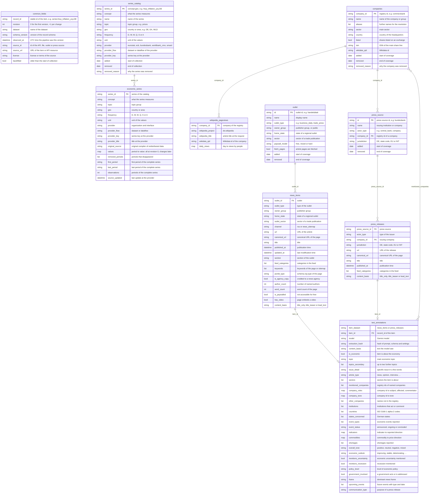

# German Economics Dataset
[](https://github.com/kleinnconrad/dataset.economics.germany/actions/workflows/ci.yml)

A dataset of the German economy for economic analysis and prediction. A pipeline in GitHub Actions runs twice a week (Tuesdays and Fridays) for at most 30 minutes. It collects statistical series (GDP, prices and inflation, interest rates, commodity prices, electricity, labour market, production, surveys including shortages), the public attention to large companies, and the economic news of German outlets and the press releases of economic institutions and companies. It labels the news and press releases with Google Gemini (`gemini-2.5-flash`) and stores everything as partitioned JSON files in this repository. Statistical series are stored as vintages, so that every past state of a revised series can be reconstructed.

## Table of Contents
- [Variable Overview](#variable-overview)
- [Dataset Overview](#dataset-overview)
- [Datasets](#datasets)
  - [Statistical Series and Vintages](#statistical-series-and-vintages)
  - [News Items and Press Releases](#news-items-and-press-releases)
- [Correlation with Other Datasets](#correlation-with-other-datasets)
- [Data Model](#data-model)
- [Example Records](#example-records)
- [Sources and Fetch Rules](#sources-and-fetch-rules)
- [Pipeline](#pipeline)
- [Data Files](#data-files)
- [Workflows](#workflows)
- [Configuration](#configuration)
- [Running Locally](#running-locally)
- [Continuous Integration](#continuous-integration)
- [Setup](#setup)
- [Sources and Attribution](#sources-and-attribution)

## Variable Overview

The table lists the variables that carry content and the dataset (table) that stores them. Statistical series are grouped by topic: every concept of a topic is stored per country or area as a series `<concept>.<geo>` in `economic_series`, with its values by period in the field `values`; the example names a series, a period, the value and the unit. All series are listed in the [Dataset Overview](#dataset-overview) and in [config/series.toml](config/series.toml). Not listed are the fields that every record has, the series catalog, ids that link the datasets, keys of the providers, URLs, external identifiers (ISIN, Wikidata), coverage dates and the bookkeeping of revisions and annotations; all fields are in the [Data Model](#data-model).

| Variable | Table | Description | Example |
|---|---|---|---|
| Series of topic `output_and_demand` | `economic_series` | GDP (real change on the previous quarter and year, real and nominal level), household and government consumption, fixed investment, exports and imports; quarterly; GDP growth for DE, EA, FR, IT, ES, NL, PL and AT | `gdp_real_qoq.DE` 2026-Q2: `0.3` (percent change on the previous quarter) |
| Series of topic `production_and_orders` | `economic_series` | Production in industry, manufacturing (total, automotive, chemicals, machinery, basic metals) and construction, manufacturing new orders (domestic, foreign, without large orders), retail sales volume; monthly; capacity utilization in industry, quarterly | `industrial_production_index.DE` 2026-08: `90.7` (index, 2021 = 100) |
| Series of topic `high_frequency_activity` | `economic_series` | Truck toll mileage index (daily) and weekly activity index of the Bundesbank | `weekly_activity_index.DE` 2026-W42: `0.1967` (percent) |
| Series of topic `prices` | `economic_series` | HICP (headline, core, energy, food, services, non-energy goods) and national CPI, producer and import prices, electricity and gas prices for households and industry; monthly, energy prices half-yearly | `hicp_inflation_yoy.DE` 2026-09: `3.3` (percent change on the same month of the previous year) |
| Series of topic `wages_and_labour_costs` | `economic_series` | Index of negotiated wages (monthly), change of the labour cost index (quarterly) | `negotiated_wages_index.DE` 2026-08: `113.7` (index, 2020 = 100) |
| Series of topic `labour_market` | `economic_series` | Registered unemployed, registered unemployment rate and vacancies, short-time workers, employment, unemployment rate (ILO) total and of young people, job vacancy rate | `unemployment_rate.DE` 2026-08: `4.0` (percent of the labour force) |
| Series of topic `interest_rates` | `economic_series` | ECB key rates, euro short-term rate, Euribor, yields of AAA euro area and German Federal securities (2 to 30 years), long-term interest rates, rates of new mortgage and corporate loans, expected real rate | `bund_yield_10y.DE` 2026-10-23: `3.39` (percent per annum) |
| Series of topic `money_and_credit` | `economic_series` | Growth of the money supply M3 and of loans to non-financial corporations | `m3_growth.EA` 2026-08: `3.489572442704003` (percent change on the same month of the previous year) |
| Series of topic `exchange_rates` | `economic_series` | ECB reference rates of the euro against the US dollar, yuan renminbi, pound sterling, Swiss franc and yen; daily | `eur_usd.EA` 2026-10-23: `1.1193` (US dollar per euro) |
| Series of topic `financial_stress` | `economic_series` | Composite Indicator of Systemic Stress (CISS) of the ECB; daily | `systemic_stress_index.DE` 2026-10-22: `0.032584226541109484` (index, 0 to 1) |
| Series of topic `public_finances` | `economic_series` | Government debt and government balance in percent of GDP; quarterly | `government_debt_ratio.DE` 2026-Q2: `63.4` (percent of GDP) |
| Series of topic `trade` | `economic_series` | Value of goods exports and imports and the trade balance; monthly | `goods_trade_balance.DE` 2026-08: `18629.4` (million euro) |
| Series of topic `sentiment_and_surveys` | `economic_series` | Economic sentiment indicator, confidence of industry, services, retail, construction and consumers, expectations of firms and consumers on production, prices, employment and unemployment; monthly | `consumer_confidence.DE` 2026-09: `-14.5` (balance of positive and negative answers) |
| Series of topic `shortages` | `economic_series` | Share of firms in industry, services and construction whose activity is limited by material or equipment, labour, demand or financial constraints | `industry_limited_by_labour.DE` 2026-Q3: `16.4` (percent of firms) |
| Series of topic `housing` | `economic_series` | House price index and its change on the previous year; quarterly | `house_prices_yoy.DE` 2026-Q2: `0.6` (percent change on the same quarter of the previous year) |
| Series of topic `business_demography` | `economic_series` | Indices of bankruptcy declarations and business registrations; monthly | `bankruptcy_declarations_index.DE` 2026-07: `197.5` (index, 2021 = 100) |
| Series of topic `commodities` | `economic_series` | World prices of energy, metals, agricultural products and fertilizers and the commodity price indices of the World Bank; monthly | `brent_crude_oil_price.WLD` 2026-09: `116.8` (US dollar per barrel) |
| Series of topic `energy` | `economic_series` | German electricity market: day-ahead price, grid load, residual load and generation by energy source; daily | `day_ahead_power_price.DE` 2026-10-24: `30.12` (euro per MWh) |
| `name` | `companies` | Name of the company or corporate group | `Commerzbank` |
| `sector` | `companies` | Main sector of the company | `Automotive` |
| `country` | `companies` | Country of the headquarters (ISO 3166-1 alpha-2) | `DE` |
| `listed` | `companies` | Shares listed on a stock exchange | `true` |
| `daily_views` | `wikipedia_pageviews` | Views by people per day of the German Wikipedia article of a company of the registry | `{"2026-10-23": 402, "2026-10-24": 446}` |
| `outlet_id` | `news_items` | Outlet that published the article | `handelsblatt` |
| `outlet_type` | `news_items` | Type of the outlet | `business_daily` |
| `owner_group` | `news_items` | Publisher group of the outlet, or `public` | `Axel Springer` |
| `home_state` | `news_items` | State of a regional outlet (ISO 3166-2) | `DE-NW` |
| `outlet_sector` | `news_items` | Sector of a trade publication | `Aviation` |
| `title` | `news_items` | Title of the article | `Verdi ruft bundesweit zu Warnstreiks bei privaten Banken auf` |
| `published_at` | `news_items` | Publication time (UTC) | `2026-10-22T07:00:00Z` |
| `updated_at` | `news_items` | Last modification time (UTC) | `2026-10-25T11:14:29Z` |
| `section` | `news_items` | Section of the outlet | `Wirtschaft` |
| `feed_categories` | `news_items` | Categories of the item in the feed | `["Wirtschaft"]` |
| `keywords` | `news_items` | Keywords of the article page or news sitemap | `["Pflegereform", "Pflegeversicherung", "Pflege"]` |
| `jsonld_type` | `news_items` | schema.org type of the page, e.g. news or opinion | `NewsArticle` |
| `is_agency_copy` | `news_items` | Credited to a news agency | `false` |
| `author_count` | `news_items` | Number of named authors (names are not stored) | `1` |
| `word_count` | `news_items` | Word count of the article | `848` |
| `is_paywalled` | `news_items` | Not accessible for free | `true` |
| `has_video` | `news_items` | Page embeds a video | `false` |
| `press_source_id` | `press_releases` | Institution, association, union or company that issued the release | `bundesbank` |
| `actor_type` | `press_releases` | Type of the issuer | `central_bank` |
| `jurisdiction` | `press_releases` | Level of the issuer: DE, a state, EU or INT | `DE` |
| `title` | `press_releases` | Title of the release | `Ergebnisse der EZB-Umfrage zu den Verbrauchererwartungen: September 2026` |
| `published_at` | `press_releases` | Publication time (UTC) | `2026-10-22T07:40:00Z` |
| `feed_categories` | `press_releases` | Categories of the item in the feed | `["Tarifmeldung"]` |
| `is_economic` | `text_annotations` | Item is about the economy | `true` |
| `topic` | `text_annotations` | Main economic topic | `Corporate strategy and results` |
| `topics_secondary` | `text_annotations` | Up to two further topics | `["Industry and manufacturing"]` |
| `issue_detail` | `text_annotations` | Specific issue in a few words | `Hafen-Finanzierung` |
| `article_type` | `text_annotations` | Form of the item: news, opinion, interview, analysis and others | `News` |
| `sectors` | `text_annotations` | Sectors the item is mainly about | `["Automotive"]` |
| `mentioned_companies` | `text_annotations` | Registry ids of the named companies | `["volkswagen"]` |
| `company_roles` | `text_annotations` | Role of each named company: subject, affected or commentator | `{"volkswagen": "Subject"}` |
| `company_tone` | `text_annotations` | Tone toward each named company | `{"volkswagen": "Negative"}` |
| `other_companies` | `text_annotations` | Named companies that are not in the registry | `["Ryanair"]` |
| `institutions` | `text_annotations` | Institutions that act, decide or comment | `["Federal government"]` |
| `countries` | `text_annotations` | Countries the item is mainly about (ISO 3166-1 alpha-2) | `["US", "DE"]` |
| `states_concerned` | `text_annotations` | German states the item is mainly about | `["DE-NW"]` |
| `event_types` | `text_annotations` | Economic events reported | `["Investment or expansion"]` |
| `event_status` | `text_annotations` | Stage of the main event | `Announced or planned` |
| `indicators` | `text_annotations` | Reported indicators with their direction | `{"Energy prices": "Rising"}` |
| `commodities` | `text_annotations` | Discussed commodities with the direction of their price | `{"Electricity": "Rising", "Natural gas": "Rising"}` |
| `shortages` | `text_annotations` | Reported shortages | `["Skilled workers"]` |
| `overall_tone` | `text_annotations` | Overall tone of the item | `Negative` |
| `economic_outlook` | `text_annotations` | Expected development as stated in the item | `Deteriorating` |
| `mentions_uncertainty` | `text_annotations` | Economic or economic policy uncertainty mentioned | `false` |
| `mentions_recession` | `text_annotations` | Recession mentioned | `false` |
| `policy_level` | `text_annotations` | Main level of economic policy addressed | `Federal` |
| `government_involved` | `text_annotations` | A government or its members act or are addressed | `true` |
| `frame` | `text_annotations` | Dominant news frame (Semetko and Valkenburg) | `Economic consequences` |
| `upcoming_events` | `text_annotations` | Future events with type and date | `[{"date": "2026-10-27", "event_type": "Earnings report"}]` |
| `communication_type` | `text_annotations` | Purpose of a press release; `Not applicable` for news | `Statistical release` |

## Dataset Overview
<!-- DATASET_OVERVIEW_START -->
**Last updated:** 2026-10-30 07:12 UTC

| Dataset | Records | Items | Files | Observed | Content |
|---|---|---|---|---|---|
| `economic_series` | 331 | 238 | 3 | 2026-10-25 to 2026-10-30 | A vintage of a statistical series: all values at the first observation, then the added, revised and removed periods. |
| `series_catalog` | 238 | 238 | 1 | 2026-10-25 to 2026-10-25 | An entry of the series catalog, recorded when it appears or changes. |
| `news_items` | 4,133 | 4,133 | 3 | 2026-10-25 to 2026-10-30 | Metadata of one news article. The text is not stored. |
| `press_releases` | 106 | 106 | 3 | 2026-10-25 to 2026-10-30 | Metadata of one press release. The text is not stored. |
| `text_annotations` | 1,200 | 1,200 | 3 | 2026-10-25 to 2026-10-30 | Gemini labels of one news article or press release. |
| `companies` | 110 | 110 | 1 | 2026-10-25 to 2026-10-25 | An entry of the company registry, recorded when it appears or changes. |
| `wikipedia_pageviews` | 110 | 110 | 1 | 2026-10-25 to 2026-10-25 | Daily views of the German Wikipedia article of a registered company. |

**Runs**

- **Latest run:** 2026-10-30 07:01 UTC (normal)
  - `bundesbank`: ok (economic_series 5)
  - `commodities`: not_due
  - `companies`: ok
  - `ecb`: ok (economic_series 13)
  - `electricity`: ok (economic_series 14)
  - `eurostat`: ok (economic_series 32)
  - `feeds`: ok (news_items 1,709, press_releases 64, text_annotations 400)
  - `series_catalog`: ok
  - `wikipedia_pageviews`: not_due

**Statistical series**

- **Active series:** 238 (eurostat 143, worldbank_cmo 35, ecb 27, bundesbank 19, smard 14); with stored values: 238

<details>
<summary>Series: latest period and number of revisions</summary>

| Series | Topic | Frequency | Unit | First period | Latest period | Periods | Revisions |
|---|---|---|---|---|---|---|---|
| `bankruptcy_declarations_index.DE` | business demography | M | index, 2021 = 100 | 2015-01 | 2026-07 | 139 | 0 |
| `business_registrations_index.DE` | business demography | M | index, 2021 = 100 | 2015-01 | 2026-08 | 140 | 0 |
| `aluminium_price.WLD` | commodities | M | US dollar per metric ton | 1960-01 | 2026-09 | 801 | 0 |
| `brent_crude_oil_price.WLD` | commodities | M | US dollar per barrel | 1960-01 | 2026-09 | 801 | 0 |
| `coal_australia_price.WLD` | commodities | M | US dollar per metric ton | 1970-01 | 2026-09 | 681 | 0 |
| `cocoa_price.WLD` | commodities | M | US dollar per kilogram | 1960-01 | 2026-09 | 801 | 0 |
| `coffee_arabica_price.WLD` | commodities | M | US dollar per kilogram | 1960-01 | 2026-09 | 801 | 0 |
| `commodity_price_index_agriculture.WLD` | commodities | M | index, 2010 = 100 (nominal US dollars) | 1960-01 | 2026-09 | 801 | 0 |
| `commodity_price_index_base_metals.WLD` | commodities | M | index, 2010 = 100 (nominal US dollars) | 1960-01 | 2026-09 | 801 | 0 |
| `commodity_price_index_energy.WLD` | commodities | M | index, 2010 = 100 (nominal US dollars) | 1960-01 | 2026-09 | 801 | 0 |
| `commodity_price_index_fertilizers.WLD` | commodities | M | index, 2010 = 100 (nominal US dollars) | 1960-01 | 2026-09 | 801 | 0 |
| `commodity_price_index_food.WLD` | commodities | M | index, 2010 = 100 (nominal US dollars) | 1960-01 | 2026-09 | 801 | 0 |
| `commodity_price_index_metals_minerals.WLD` | commodities | M | index, 2010 = 100 (nominal US dollars) | 1960-01 | 2026-09 | 801 | 0 |
| `commodity_price_index_non_energy.WLD` | commodities | M | index, 2010 = 100 (nominal US dollars) | 1960-01 | 2026-09 | 801 | 0 |
| `commodity_price_index_precious_metals.WLD` | commodities | M | index, 2010 = 100 (nominal US dollars) | 1960-01 | 2026-09 | 801 | 0 |
| `commodity_price_index_total.WLD` | commodities | M | index, 2010 = 100 (nominal US dollars) | 1960-01 | 2026-09 | 801 | 0 |
| `copper_price.WLD` | commodities | M | US dollar per metric ton | 1960-01 | 2026-09 | 801 | 0 |
| `cotton_price.WLD` | commodities | M | US dollar per kilogram | 1960-01 | 2026-09 | 801 | 0 |
| `crude_oil_average_price.WLD` | commodities | M | US dollar per barrel | 1960-01 | 2026-09 | 801 | 0 |
| `dap_fertilizer_price.WLD` | commodities | M | US dollar per metric ton | 1967-01 | 2026-09 | 717 | 0 |
| `gold_price.WLD` | commodities | M | US dollar per troy ounce | 1960-01 | 2026-09 | 801 | 0 |
| `iron_ore_price.WLD` | commodities | M | US dollar per dry metric ton unit | 1960-01 | 2026-09 | 801 | 0 |
| `lead_price.WLD` | commodities | M | US dollar per metric ton | 1960-01 | 2026-09 | 801 | 0 |
| `maize_price.WLD` | commodities | M | US dollar per metric ton | 1960-01 | 2026-09 | 801 | 0 |
| `natural_gas_europe_price.WLD` | commodities | M | US dollar per million British thermal units | 1960-01 | 2026-09 | 801 | 0 |
| `natural_gas_us_price.WLD` | commodities | M | US dollar per million British thermal units | 1960-01 | 2026-09 | 801 | 0 |
| `nickel_price.WLD` | commodities | M | US dollar per metric ton | 1960-01 | 2026-09 | 801 | 0 |
| `palm_oil_price.WLD` | commodities | M | US dollar per metric ton | 1960-01 | 2026-09 | 801 | 0 |
| `platinum_price.WLD` | commodities | M | US dollar per troy ounce | 1960-01 | 2026-09 | 801 | 0 |
| `potassium_chloride_price.WLD` | commodities | M | US dollar per metric ton | 1960-01 | 2026-09 | 801 | 0 |
| `silver_price.WLD` | commodities | M | US dollar per troy ounce | 1960-01 | 2026-09 | 801 | 0 |
| `soybeans_price.WLD` | commodities | M | US dollar per metric ton | 1960-01 | 2026-09 | 801 | 0 |
| `sugar_world_price.WLD` | commodities | M | US dollar per kilogram | 1960-01 | 2026-09 | 801 | 0 |
| `tin_price.WLD` | commodities | M | US dollar per metric ton | 1960-01 | 2026-09 | 801 | 0 |
| `urea_price.WLD` | commodities | M | US dollar per metric ton | 1960-01 | 2026-09 | 801 | 0 |
| `wheat_price.WLD` | commodities | M | US dollar per metric ton | 1960-01 | 2026-09 | 801 | 0 |
| `zinc_price.WLD` | commodities | M | US dollar per metric ton | 1960-01 | 2026-09 | 801 | 0 |
| `day_ahead_power_price.DE` | energy | D | euro per MWh | 2018-10-01 | 2026-10-29 | 2,951 | 2 |
| `grid_load.DE` | energy | D | MWh per day | 2015-01-01 | 2026-10-29 | 4,320 | 2 |
| `power_generation_biomass.DE` | energy | D | MWh per day | 2015-01-01 | 2026-10-29 | 4,320 | 2 |
| `power_generation_hard_coal.DE` | energy | D | MWh per day | 2015-01-01 | 2026-10-28 | 4,319 | 2 |
| `power_generation_hydro.DE` | energy | D | MWh per day | 2015-01-01 | 2026-10-29 | 4,320 | 2 |
| `power_generation_lignite.DE` | energy | D | MWh per day | 2015-01-01 | 2026-10-28 | 4,319 | 2 |
| `power_generation_natural_gas.DE` | energy | D | MWh per day | 2015-01-01 | 2026-10-29 | 4,320 | 2 |
| `power_generation_other_conventional.DE` | energy | D | MWh per day | 2015-01-01 | 2026-10-29 | 4,320 | 2 |
| `power_generation_other_renewable.DE` | energy | D | MWh per day | 2015-01-01 | 2026-10-29 | 4,319 | 2 |
| `power_generation_pumped_storage.DE` | energy | D | MWh per day | 2015-01-01 | 2026-10-29 | 4,316 | 2 |
| `power_generation_solar.DE` | energy | D | MWh per day | 2015-01-01 | 2026-10-29 | 4,320 | 2 |
| `power_generation_wind_offshore.DE` | energy | D | MWh per day | 2015-01-01 | 2026-10-29 | 4,320 | 2 |
| `power_generation_wind_onshore.DE` | energy | D | MWh per day | 2015-01-01 | 2026-10-29 | 4,320 | 2 |
| `residual_load.DE` | energy | D | MWh per day | 2015-01-01 | 2026-10-29 | 4,320 | 2 |
| `eur_chf.EA` | exchange rates | D | Swiss franc per euro | 1999-01-04 | 2026-10-29 | 7,125 | 2 |
| `eur_cny.EA` | exchange rates | D | yuan renminbi per euro | 2000-01-13 | 2026-10-29 | 6,858 | 2 |
| `eur_gbp.EA` | exchange rates | D | pound sterling per euro | 1999-01-04 | 2026-10-29 | 7,125 | 2 |
| `eur_jpy.EA` | exchange rates | D | yen per euro | 1999-01-04 | 2026-10-29 | 7,125 | 2 |
| `eur_usd.EA` | exchange rates | D | US dollar per euro | 1999-01-04 | 2026-10-29 | 7,125 | 2 |
| `systemic_stress_index.DE` | financial stress | D | index (0 to 1) | 1980-01-04 | 2026-10-28 | 12,216 | 2 |
| `systemic_stress_index.EA` | financial stress | D | index (0 to 1) | 1980-01-03 | 2026-10-28 | 12,223 | 2 |
| `truck_toll_mileage_index.DE` | high frequency activity | D | index, 2021 = 100 | 2008-01-01 | 2026-10-24 | 6,872 | 1 |
| `weekly_activity_index.DE` | high frequency activity | W | percent | 2004-W27 | 2026-W43 | 1,165 | 1 |
| `house_price_index.DE` | housing | Q | index, 2015 = 100 | 2005-Q1 | 2026-Q2 | 86 | 0 |
| `house_prices_yoy.DE` | housing | Q | percent change on the same quarter of the previous year | 2006-Q1 | 2026-Q2 | 82 | 0 |
| `house_prices_yoy.EA` | housing | Q | percent change on the same quarter of the previous year | 2006-Q1 | 2026-Q2 | 82 | 0 |
| `bund_yield_10y.DE` | interest rates | D | percent per annum | 1997-08-07 | 2026-10-29 | 7,420 | 2 |
| `bund_yield_2y.DE` | interest rates | D | percent per annum | 1997-08-07 | 2026-10-29 | 7,420 | 2 |
| `bund_yield_30y.DE` | interest rates | D | percent per annum | 2000-08-01 | 2026-10-29 | 6,668 | 2 |
| `bund_yield_5y.DE` | interest rates | D | percent per annum | 1997-08-07 | 2026-10-29 | 7,420 | 2 |
| `corporate_loan_rate_new_business.DE` | interest rates | M | percent per annum | 2000-01 | 2026-08 | 320 | 0 |
| `corporate_loan_rate_new_business.EA` | interest rates | M | percent per annum | 2000-01 | 2026-08 | 320 | 0 |
| `ecb_deposit_facility_rate.EA` | interest rates | D | percent per annum | 1999-01-01 | 2026-09-16 | 69 | 0 |
| `ecb_main_refinancing_rate.EA` | interest rates | D | percent per annum | 1999-01-01 | 2026-09-16 | 48 | 0 |
| `ecb_marginal_lending_rate.EA` | interest rates | D | percent per annum | 1999-01-01 | 2026-09-16 | 69 | 0 |
| `euribor_12m.EA` | interest rates | M | percent per annum | 1994-01 | 2026-09 | 393 | 0 |
| `euribor_3m.EA` | interest rates | M | percent per annum | 1994-01 | 2026-09 | 393 | 0 |
| `euro_area_aaa_yield_10y.EA` | interest rates | D | percent per annum | 2004-09-06 | 2026-10-28 | 5,662 | 2 |
| `euro_area_aaa_yield_2y.EA` | interest rates | D | percent per annum | 2004-09-06 | 2026-10-28 | 5,662 | 2 |
| `euro_short_term_rate.EA` | interest rates | D | percent per annum | 2019-10-01 | 2026-10-29 | 1,814 | 2 |
| `expected_real_rate_10y.DE` | interest rates | M | percent per annum | 1989-10 | 2026-10 | 445 | 0 |
| `long_term_interest_rate.DE` | interest rates | M | percent per annum | 1990-01 | 2026-09 | 441 | 0 |
| `long_term_interest_rate.ES` | interest rates | M | percent per annum | 1991-11 | 2026-09 | 419 | 0 |
| `long_term_interest_rate.FR` | interest rates | M | percent per annum | 1986-01 | 2026-09 | 489 | 0 |
| `long_term_interest_rate.IT` | interest rates | M | percent per annum | 1991-03 | 2026-09 | 427 | 0 |
| `long_term_interest_rate.NL` | interest rates | M | percent per annum | 1986-04 | 2026-09 | 486 | 0 |
| `mortgage_rate_new_business.DE` | interest rates | M | percent per annum | 2003-01 | 2026-08 | 284 | 0 |
| `mortgage_rate_new_business.EA` | interest rates | M | percent per annum | 2003-01 | 2026-08 | 284 | 0 |
| `employment_persons.DE` | labour market | M | thousand persons | 1991-01 | 2026-08 | 428 | 0 |
| `employment_qoq.DE` | labour market | Q | percent change on the previous quarter | 1991-Q2 | 2026-Q2 | 141 | 0 |
| `employment_qoq.EA` | labour market | Q | percent change on the previous quarter | 1995-Q2 | 2026-Q2 | 125 | 0 |
| `job_vacancy_rate.DE` | labour market | Q | percent of occupied and vacant posts | 2006-Q1 | 2026-Q2 | 82 | 0 |
| `job_vacancy_rate.EA` | labour market | Q | percent of occupied and vacant posts | 2006-Q1 | 2026-Q2 | 82 | 0 |
| `registered_unemployed.DE` | labour market | M | thousand persons | 1991-12 | 2026-09 | 418 | 0 |
| `registered_unemployment_rate.DE` | labour market | M | percent of the civilian labour force | 1991-12 | 2026-09 | 418 | 0 |
| `registered_vacancies.DE` | labour market | M | thousand | 2000-01 | 2026-09 | 321 | 0 |
| `short_time_workers.DE` | labour market | M | persons | 1995-01 | 2026-07 | 379 | 0 |
| `unemployment_rate.AT` | labour market | M | percent of the labour force | 1995-01 | 2026-08 | 380 | 0 |
| `unemployment_rate.DE` | labour market | M | percent of the labour force | 1991-01 | 2026-08 | 428 | 0 |
| `unemployment_rate.EA` | labour market | M | percent of the labour force | 2000-01 | 2026-08 | 320 | 0 |
| `unemployment_rate.ES` | labour market | M | percent of the labour force | 1986-04 | 2026-08 | 485 | 0 |
| `unemployment_rate.FR` | labour market | M | percent of the labour force | 1983-01 | 2026-08 | 524 | 0 |
| `unemployment_rate.IT` | labour market | M | percent of the labour force | 1983-01 | 2026-08 | 524 | 0 |
| `unemployment_rate.NL` | labour market | M | percent of the labour force | 1983-01 | 2026-09 | 525 | 0 |
| `unemployment_rate.PL` | labour market | M | percent of the labour force | 1997-01 | 2026-08 | 356 | 0 |
| `youth_unemployment_rate.DE` | labour market | M | percent of the labour force | 1991-01 | 2026-08 | 428 | 0 |
| `youth_unemployment_rate.EA` | labour market | M | percent of the labour force | 2000-01 | 2026-08 | 320 | 0 |
| `corporate_loans_growth.DE` | money and credit | M | percent change on the same month of the previous year | 2004-01 | 2026-09 | 273 | 1 |
| `corporate_loans_growth.EA` | money and credit | M | percent change on the same month of the previous year | 2004-01 | 2026-09 | 273 | 1 |
| `m3_growth.EA` | money and credit | M | percent change on the same month of the previous year | 1981-01 | 2026-09 | 549 | 1 |
| `exports_real_qoq.DE` | output and demand | Q | percent change on the previous quarter | 1991-Q2 | 2026-Q2 | 141 | 0 |
| `fixed_investment_real_qoq.DE` | output and demand | Q | percent change on the previous quarter | 1991-Q2 | 2026-Q2 | 141 | 0 |
| `gdp_nominal_level.DE` | output and demand | Q | million euro, current prices | 1991-Q1 | 2026-Q2 | 142 | 0 |
| `gdp_real_level.DE` | output and demand | Q | million euro, chain-linked volumes (2020) | 1991-Q1 | 2026-Q2 | 142 | 0 |
| `gdp_real_level.EA` | output and demand | Q | million euro, chain-linked volumes (2020) | 1995-Q1 | 2026-Q2 | 126 | 0 |
| `gdp_real_qoq.AT` | output and demand | Q | percent change on the previous quarter | 1995-Q2 | 2026-Q2 | 125 | 0 |
| `gdp_real_qoq.DE` | output and demand | Q | percent change on the previous quarter | 1991-Q2 | 2026-Q2 | 141 | 0 |
| `gdp_real_qoq.EA` | output and demand | Q | percent change on the previous quarter | 1995-Q2 | 2026-Q2 | 125 | 0 |
| `gdp_real_qoq.ES` | output and demand | Q | percent change on the previous quarter | 1995-Q2 | 2026-Q2 | 125 | 0 |
| `gdp_real_qoq.FR` | output and demand | Q | percent change on the previous quarter | 1980-Q2 | 2026-Q2 | 185 | 0 |
| `gdp_real_qoq.IT` | output and demand | Q | percent change on the previous quarter | 1996-Q2 | 2026-Q2 | 121 | 0 |
| `gdp_real_qoq.NL` | output and demand | Q | percent change on the previous quarter | 1996-Q2 | 2026-Q2 | 121 | 0 |
| `gdp_real_qoq.PL` | output and demand | Q | percent change on the previous quarter | 1995-Q2 | 2026-Q2 | 125 | 0 |
| `gdp_real_yoy.AT` | output and demand | Q | percent change on the same quarter of the previous year | 1996-Q1 | 2026-Q2 | 122 | 0 |
| `gdp_real_yoy.DE` | output and demand | Q | percent change on the same quarter of the previous year | 1992-Q1 | 2026-Q2 | 138 | 0 |
| `gdp_real_yoy.EA` | output and demand | Q | percent change on the same quarter of the previous year | 1996-Q1 | 2026-Q2 | 122 | 0 |
| `gdp_real_yoy.ES` | output and demand | Q | percent change on the same quarter of the previous year | 1996-Q1 | 2026-Q2 | 122 | 0 |
| `gdp_real_yoy.FR` | output and demand | Q | percent change on the same quarter of the previous year | 1981-Q1 | 2026-Q2 | 182 | 0 |
| `gdp_real_yoy.IT` | output and demand | Q | percent change on the same quarter of the previous year | 1997-Q1 | 2026-Q2 | 118 | 0 |
| `gdp_real_yoy.NL` | output and demand | Q | percent change on the same quarter of the previous year | 1997-Q1 | 2026-Q2 | 118 | 0 |
| `gdp_real_yoy.PL` | output and demand | Q | percent change on the same quarter of the previous year | 1996-Q1 | 2026-Q2 | 122 | 0 |
| `government_consumption_real_qoq.DE` | output and demand | Q | percent change on the previous quarter | 1991-Q2 | 2026-Q2 | 141 | 0 |
| `household_consumption_real_qoq.DE` | output and demand | Q | percent change on the previous quarter | 1991-Q2 | 2026-Q2 | 141 | 0 |
| `imports_real_qoq.DE` | output and demand | Q | percent change on the previous quarter | 1991-Q2 | 2026-Q2 | 141 | 0 |
| `cpi_index.DE` | prices | M | index, 2020 = 100 | 1991-01 | 2026-09 | 429 | 0 |
| `cpi_inflation_yoy.DE` | prices | M | percent change on the same month of the previous year | 1949-06 | 2026-09 | 928 | 0 |
| `hicp_core_inflation_yoy.DE` | prices | M | percent change on the same month of the previous year | 1997-01 | 2026-09 | 357 | 0 |
| `hicp_core_inflation_yoy.EA` | prices | M | percent change on the same month of the previous year | 2000-12 | 2026-09 | 310 | 0 |
| `hicp_energy_inflation_yoy.DE` | prices | M | percent change on the same month of the previous year | 1997-01 | 2026-09 | 357 | 0 |
| `hicp_energy_inflation_yoy.EA` | prices | M | percent change on the same month of the previous year | 1997-01 | 2026-09 | 357 | 0 |
| `hicp_food_inflation_yoy.DE` | prices | M | percent change on the same month of the previous year | 1997-01 | 2026-09 | 357 | 0 |
| `hicp_food_inflation_yoy.EA` | prices | M | percent change on the same month of the previous year | 1997-01 | 2026-09 | 357 | 0 |
| `hicp_index.DE` | prices | M | index, 2025 = 100 | 1996-01 | 2026-09 | 369 | 0 |
| `hicp_index.EA` | prices | M | index, 2025 = 100 | 1996-01 | 2026-09 | 369 | 0 |
| `hicp_inflation_mom.DE` | prices | M | percent change on the previous month | 1996-02 | 2026-09 | 368 | 0 |
| `hicp_inflation_mom.EA` | prices | M | percent change on the previous month | 1996-02 | 2026-09 | 368 | 0 |
| `hicp_inflation_yoy.AT` | prices | M | percent change on the same month of the previous year | 1997-01 | 2026-09 | 357 | 0 |
| `hicp_inflation_yoy.DE` | prices | M | percent change on the same month of the previous year | 1997-01 | 2026-09 | 357 | 0 |
| `hicp_inflation_yoy.EA` | prices | M | percent change on the same month of the previous year | 1997-01 | 2026-09 | 357 | 0 |
| `hicp_inflation_yoy.ES` | prices | M | percent change on the same month of the previous year | 1997-01 | 2026-09 | 357 | 0 |
| `hicp_inflation_yoy.FR` | prices | M | percent change on the same month of the previous year | 1997-01 | 2026-09 | 357 | 0 |
| `hicp_inflation_yoy.IT` | prices | M | percent change on the same month of the previous year | 1997-01 | 2026-09 | 357 | 0 |
| `hicp_inflation_yoy.NL` | prices | M | percent change on the same month of the previous year | 1997-01 | 2026-09 | 357 | 0 |
| `hicp_inflation_yoy.PL` | prices | M | percent change on the same month of the previous year | 1997-01 | 2026-09 | 357 | 0 |
| `hicp_non_energy_goods_inflation_yoy.DE` | prices | M | percent change on the same month of the previous year | 1997-01 | 2026-09 | 357 | 0 |
| `hicp_non_energy_goods_inflation_yoy.EA` | prices | M | percent change on the same month of the previous year | 2000-12 | 2026-09 | 310 | 0 |
| `hicp_services_inflation_yoy.DE` | prices | M | percent change on the same month of the previous year | 1997-01 | 2026-09 | 357 | 0 |
| `hicp_services_inflation_yoy.EA` | prices | M | percent change on the same month of the previous year | 2000-12 | 2026-09 | 310 | 0 |
| `household_electricity_price.DE` | prices | S | euro per kWh | 2007-S1 | 2026-S1 | 39 | 0 |
| `household_electricity_price.EA` | prices | S | euro per kWh | 2007-S1 | 2026-S1 | 39 | 0 |
| `household_electricity_price.EU27_2020` | prices | S | euro per kWh | 2007-S1 | 2026-S1 | 39 | 0 |
| `household_electricity_price.FR` | prices | S | euro per kWh | 2007-S2 | 2026-S1 | 38 | 0 |
| `household_electricity_price.IT` | prices | S | euro per kWh | 2008-S1 | 2026-S1 | 37 | 0 |
| `household_gas_price.DE` | prices | S | euro per kWh | 2007-S2 | 2026-S1 | 38 | 0 |
| `household_gas_price.EA` | prices | S | euro per kWh | 2007-S1 | 2026-S1 | 39 | 0 |
| `household_gas_price.EU27_2020` | prices | S | euro per kWh | 2007-S1 | 2026-S1 | 39 | 0 |
| `import_prices_energy_yoy.DE` | prices | M | percent change on the same month of the previous year | 1996-01 | 2026-08 | 368 | 0 |
| `import_prices_yoy.DE` | prices | M | percent change on the same month of the previous year | 1963-01 | 2026-08 | 764 | 0 |
| `industrial_electricity_price.DE` | prices | S | euro per kWh | 2007-S1 | 2026-S1 | 39 | 0 |
| `industrial_electricity_price.EA` | prices | S | euro per kWh | 2007-S1 | 2026-S1 | 39 | 0 |
| `industrial_electricity_price.EU27_2020` | prices | S | euro per kWh | 2007-S1 | 2026-S1 | 39 | 0 |
| `industrial_electricity_price.FR` | prices | S | euro per kWh | 2007-S2 | 2026-S1 | 38 | 0 |
| `industrial_electricity_price.IT` | prices | S | euro per kWh | 2008-S1 | 2026-S1 | 37 | 0 |
| `industrial_gas_price.DE` | prices | S | euro per kWh | 2007-S2 | 2026-S1 | 38 | 0 |
| `industrial_gas_price.EA` | prices | S | euro per kWh | 2007-S1 | 2026-S1 | 39 | 0 |
| `industrial_gas_price.EU27_2020` | prices | S | euro per kWh | 2007-S1 | 2026-S1 | 39 | 0 |
| `producer_prices_energy_yoy.DE` | prices | M | percent change on the same month of the previous year | 2001-01 | 2026-08 | 308 | 0 |
| `producer_prices_index.DE` | prices | M | index, 2021 = 100 | 2000-01 | 2026-08 | 320 | 0 |
| `producer_prices_yoy.DE` | prices | M | percent change on the same month of the previous year | 2001-01 | 2026-08 | 308 | 0 |
| `producer_prices_yoy.EA` | prices | M | percent change on the same month of the previous year | 2001-01 | 2026-08 | 308 | 0 |
| `automotive_production_index.DE` | production and orders | M | index, 2021 = 100 | 1991-01 | 2026-08 | 428 | 0 |
| `basic_metals_production_index.DE` | production and orders | M | index, 2021 = 100 | 1991-01 | 2026-08 | 428 | 0 |
| `capacity_utilization_industry.DE` | production and orders | Q | percent | 1980-Q1 | 2026-Q4 | 188 | 1 |
| `capacity_utilization_industry.EA` | production and orders | Q | percent | 1980-Q1 | 2026-Q4 | 188 | 1 |
| `chemicals_production_index.DE` | production and orders | M | index, 2021 = 100 | 1991-01 | 2026-08 | 428 | 0 |
| `construction_production_index.DE` | production and orders | M | index, 2021 = 100 | 1991-01 | 2026-08 | 428 | 0 |
| `construction_production_index.EA` | production and orders | M | index, 2021 = 100 | 1995-01 | 2026-08 | 380 | 0 |
| `industrial_production_index.DE` | production and orders | M | index, 2021 = 100 | 1991-01 | 2026-08 | 428 | 0 |
| `industrial_production_index.EA` | production and orders | M | index, 2021 = 100 | 1991-01 | 2026-08 | 428 | 0 |
| `industrial_production_index.FR` | production and orders | M | index, 2021 = 100 | 1990-01 | 2026-08 | 440 | 0 |
| `industrial_production_index.IT` | production and orders | M | index, 2021 = 100 | 1990-01 | 2026-08 | 440 | 0 |
| `machinery_production_index.DE` | production and orders | M | index, 2021 = 100 | 1991-01 | 2026-08 | 428 | 0 |
| `manufacturing_new_orders_domestic_index.DE` | production and orders | M | index, 2021 = 100 | 1991-01 | 2026-08 | 428 | 0 |
| `manufacturing_new_orders_ex_large_index.DE` | production and orders | M | index, 2021 = 100 | 2010-01 | 2026-08 | 200 | 0 |
| `manufacturing_new_orders_foreign_index.DE` | production and orders | M | index, 2021 = 100 | 1991-01 | 2026-08 | 428 | 0 |
| `manufacturing_new_orders_index.DE` | production and orders | M | index, 2021 = 100 | 1991-01 | 2026-08 | 428 | 0 |
| `manufacturing_production_index.DE` | production and orders | M | index, 2021 = 100 | 1991-01 | 2026-08 | 428 | 0 |
| `retail_sales_volume_index.DE` | production and orders | M | index, 2021 = 100 | 1994-01 | 2026-08 | 392 | 0 |
| `retail_sales_volume_index.EA` | production and orders | M | index, 2021 = 100 | 2000-01 | 2026-08 | 320 | 0 |
| `government_balance_ratio.DE` | public finances | Q | percent of GDP | 2002-Q1 | 2026-Q2 | 98 | 0 |
| `government_balance_ratio.EA` | public finances | Q | percent of GDP | 2002-Q1 | 2026-Q2 | 98 | 0 |
| `government_debt_ratio.DE` | public finances | Q | percent of GDP | 2000-Q1 | 2026-Q2 | 106 | 0 |
| `government_debt_ratio.EA` | public finances | Q | percent of GDP | 2000-Q1 | 2026-Q2 | 106 | 0 |
| `government_debt_ratio.FR` | public finances | Q | percent of GDP | 2000-Q1 | 2026-Q2 | 106 | 0 |
| `government_debt_ratio.IT` | public finances | Q | percent of GDP | 2000-Q1 | 2026-Q2 | 106 | 0 |
| `construction_confidence.DE` | sentiment and surveys | M | balance of positive and negative answers | 1980-01 | 2026-10 | 562 | 1 |
| `consumer_confidence.DE` | sentiment and surveys | M | balance of positive and negative answers | 1985-01 | 2026-10 | 502 | 1 |
| `consumer_confidence.EA` | sentiment and surveys | M | balance of positive and negative answers | 1985-01 | 2026-10 | 502 | 1 |
| `consumer_price_expectations.DE` | sentiment and surveys | M | balance of positive and negative answers | 1985-01 | 2026-10 | 502 | 1 |
| `consumer_price_expectations.EA` | sentiment and surveys | M | balance of positive and negative answers | 1985-01 | 2026-10 | 502 | 1 |
| `consumer_unemployment_expectations.DE` | sentiment and surveys | M | balance of positive and negative answers | 1985-01 | 2026-10 | 502 | 1 |
| `economic_sentiment_indicator.DE` | sentiment and surveys | M | index, long-term average = 100 | 1980-01 | 2026-10 | 562 | 1 |
| `economic_sentiment_indicator.EA` | sentiment and surveys | M | index, long-term average = 100 | 1980-01 | 2026-10 | 562 | 1 |
| `economic_sentiment_indicator.FR` | sentiment and surveys | M | index, long-term average = 100 | 1985-01 | 2026-10 | 502 | 1 |
| `economic_sentiment_indicator.IT` | sentiment and surveys | M | index, long-term average = 100 | 1980-01 | 2026-10 | 561 | 1 |
| `industry_confidence.DE` | sentiment and surveys | M | balance of positive and negative answers | 1980-01 | 2026-10 | 562 | 1 |
| `industry_confidence.EA` | sentiment and surveys | M | balance of positive and negative answers | 1980-01 | 2026-10 | 562 | 1 |
| `industry_employment_expectations.DE` | sentiment and surveys | M | balance of positive and negative answers | 1982-03 | 2026-10 | 458 | 1 |
| `industry_production_expectations.DE` | sentiment and surveys | M | balance of positive and negative answers | 1980-01 | 2026-10 | 562 | 1 |
| `industry_selling_price_expectations.DE` | sentiment and surveys | M | balance of positive and negative answers | 1980-01 | 2026-10 | 562 | 1 |
| `industry_selling_price_expectations.EA` | sentiment and surveys | M | balance of positive and negative answers | 1980-01 | 2026-10 | 562 | 1 |
| `retail_confidence.DE` | sentiment and surveys | M | balance of positive and negative answers | 1984-02 | 2026-10 | 513 | 1 |
| `services_confidence.DE` | sentiment and surveys | M | balance of positive and negative answers | 1995-04 | 2026-10 | 379 | 1 |
| `services_confidence.EA` | sentiment and surveys | M | balance of positive and negative answers | 1995-04 | 2026-10 | 379 | 1 |
| `construction_limited_by_labour.DE` | shortages | M | percent of firms | 1991-01 | 2026-10 | 430 | 1 |
| `construction_limited_by_material.DE` | shortages | M | percent of firms | 1991-01 | 2026-10 | 430 | 1 |
| `industry_limited_by_demand.DE` | shortages | Q | percent of firms | 1982-Q2 | 2026-Q4 | 179 | 1 |
| `industry_limited_by_financial_constraints.DE` | shortages | Q | percent of firms | 1982-Q2 | 2026-Q4 | 136 | 1 |
| `industry_limited_by_labour.DE` | shortages | Q | percent of firms | 1982-Q2 | 2026-Q4 | 179 | 1 |
| `industry_limited_by_labour.EA` | shortages | Q | percent of firms | 1982-Q3 | 2026-Q4 | 178 | 1 |
| `industry_limited_by_material_equipment.DE` | shortages | Q | percent of firms | 1982-Q2 | 2026-Q4 | 179 | 1 |
| `industry_limited_by_material_equipment.EA` | shortages | Q | percent of firms | 1982-Q3 | 2026-Q4 | 178 | 1 |
| `industry_not_limited.DE` | shortages | Q | percent of firms | 1982-Q2 | 2026-Q4 | 179 | 1 |
| `services_limited_by_labour.DE` | shortages | Q | percent of firms | 2003-Q3 | 2026-Q4 | 94 | 1 |
| `services_limited_by_space_equipment.DE` | shortages | Q | percent of firms | 2003-Q3 | 2026-Q4 | 94 | 1 |
| `goods_exports_value.DE` | trade | M | million euro | 2002-01 | 2026-08 | 296 | 0 |
| `goods_imports_value.DE` | trade | M | million euro | 2002-01 | 2026-08 | 296 | 0 |
| `goods_trade_balance.DE` | trade | M | million euro | 2002-01 | 2026-08 | 296 | 0 |
| `labour_cost_index_yoy.DE` | wages and labour costs | Q | percent change on the same quarter of the previous year | 1997-Q1 | 2026-Q2 | 118 | 0 |
| `labour_cost_index_yoy.EA` | wages and labour costs | Q | percent change on the same quarter of the previous year | 2009-Q1 | 2026-Q2 | 70 | 0 |
| `negotiated_wages_index.DE` | wages and labour costs | M | index, 2020 = 100 | 1991-01 | 2026-08 | 428 | 0 |

</details>

| Topic | Series |
|---|---|
| business demography | 2 |
| commodities | 35 |
| energy | 14 |
| exchange rates | 5 |
| financial stress | 2 |
| high frequency activity | 2 |
| housing | 3 |
| interest rates | 22 |
| labour market | 19 |
| money and credit | 3 |
| output and demand | 24 |
| prices | 46 |
| production and orders | 19 |
| public finances | 6 |
| sentiment and surveys | 19 |
| shortages | 11 |
| trade | 3 |
| wages and labour costs | 3 |

**Companies**

- **Registered companies:** 110 (90 listed, 82 with headquarters in Germany)

**Companies named most often, last 30 days**

| Company | Annotated items |
|---|---|
| Volkswagen | 57 |
| Alphabet | 20 |
| Deutsche Telekom | 14 |
| Microsoft | 14 |
| Amazon | 12 |
| Porsche | 10 |
| BMW | 9 |
| Lufthansa | 9 |
| Nvidia | 9 |
| Apple | 9 |

**Sources**

- **News outlets:** 51 configured (50 active, 1 blocked)
- **Press-release sources:** 18 configured (17 active, 1 blocked)

<details>
<summary>News outlets: items per source</summary>

| Source | Type | Status | Items | Last 30 days | Annotated | With lead text | Latest publication |
|---|---|---|---|---|---|---|---|
| agrarzeitung | trade press | active | 78 | 78 | 29.5% (23) | 0.0% (0) | 2026-10-30 |
| airliners.de | trade press | active | 135 | 135 | 17.8% (24) | 0.0% (0) | 2026-10-30 |
| Augsburger Allgemeine | regional daily | active | 40 | 40 | 60.0% (24) | 0.0% (0) | 2026-10-30 |
| Automobilwoche | trade press | active | 58 | 58 | 41.4% (24) | 39.7% (23) | 2026-10-30 |
| Berliner Zeitung | regional daily | active | 50 | 50 | 46.0% (23) | 46.0% (23) | 2026-10-29 |
| Bild | tabloid | active | 13 | 13 | 76.9% (10) | 76.9% (10) | 2026-10-30 |
| BR24 | public broadcaster regional | active | 37 | 37 | 62.2% (23) | 0.0% (0) | 2026-10-30 |
| Börsen-Zeitung | business daily | active | 295 | 295 | 8.5% (25) | 8.5% (25) | 2026-10-29 |
| Capital | business magazine | active | 58 | 58 | 43.1% (25) | 0.0% (0) | 2026-10-30 |
| CHEManager | trade press | active | 15 | 15 | 86.7% (13) | 86.7% (13) | 2026-10-29 |
| Der Spiegel | weekly magazine | active | 73 | 73 | 34.2% (25) | 0.0% (0) | 2026-10-30 |
| Der Tagesspiegel | national daily | active | 160 | 160 | 15.6% (25) | 0.0% (0) | 2026-10-30 |
| Deutsche Handwerks Zeitung | trade press | active | 35 | 35 | 62.9% (22) | 0.0% (0) | 2026-10-29 |
| Deutschlandfunk | public broadcaster national | active | 5 | 5 | 100.0% (5) | 100.0% (5) | 2026-10-29 |
| Die Welt | national daily | active | 617 | 617 | 4.2% (26) | 3.9% (24) | 2026-10-30 |
| DWDL.de | trade press | active | 73 | 73 | 31.5% (23) | 31.5% (23) | 2026-10-29 |
| ES&T | trade press | active | 18 | 18 | 100.0% (18) | 100.0% (18) | 2026-10-29 |
| FinanzNachrichten.de | financial portal | active | 60 | 60 | 40.0% (24) | 40.0% (24) | 2026-10-29 |
| Focus Online | weekly magazine | active | 126 | 126 | 19.8% (25) | 19.8% (25) | 2026-10-30 |
| Freie Presse | regional daily | active | 35 | 35 | 68.6% (24) | 0.0% (0) | 2026-10-30 |
| Hamburger Abendblatt | regional daily | active | 81 | 81 | 29.6% (24) | 12.3% (10) | 2026-10-29 |
| Handelsblatt | business daily | active | 380 | 380 | 6.6% (25) | 6.3% (24) | 2026-10-30 |
| hessenschau.de | public broadcaster regional | active | 12 | 12 | 100.0% (12) | 0.0% (0) | 2026-10-29 |
| Immobilien Zeitung | trade press | blocked | 0 | 0 | 0.0% (0) | 0.0% (0) | none |
| Kölner Stadt-Anzeiger | regional daily | active | 24 | 24 | 87.5% (21) | 87.5% (21) | 2026-10-29 |
| manager magazin | business magazine | active | 77 | 77 | 32.5% (25) | 0.0% (0) | 2026-10-30 |
| MDR | public broadcaster regional | active | 9 | 9 | 100.0% (9) | 0.0% (0) | 2026-10-30 |
| n-tv.de | online only | active | 73 | 73 | 32.9% (24) | 32.9% (24) | 2026-10-30 |
| Neue Osnabrücker Zeitung | regional daily | active | 81 | 81 | 29.6% (24) | 0.0% (0) | 2026-10-30 |
| onvista | financial portal | active | 98 | 98 | 24.5% (24) | 0.0% (0) | 2026-10-30 |
| Pharmazeutische Zeitung | trade press | active | 47 | 47 | 34.0% (16) | 0.0% (0) | 2026-10-26 |
| pv magazine Deutschland | trade press | active | 27 | 27 | 81.5% (22) | 0.0% (0) | 2026-10-29 |
| rbb24 | public broadcaster regional | active | 12 | 12 | 100.0% (12) | 0.0% (0) | 2026-10-29 |
| Rheinische Post | regional daily | active | 52 | 52 | 46.2% (24) | 0.0% (0) | 2026-10-30 |
| Stern | weekly magazine | active | 60 | 60 | 41.7% (25) | 0.0% (0) | 2026-10-30 |
| Stuttgarter Zeitung | regional daily | active | 95 | 95 | 25.3% (24) | 0.0% (0) | 2026-10-30 |
| Süddeutsche Zeitung | national daily | active | 44 | 44 | 59.1% (26) | 0.0% (0) | 2026-10-30 |
| t-online | online only | active | 34 | 34 | 70.6% (24) | 0.0% (0) | 2026-10-30 |
| t3n | trade press | active | 60 | 60 | 40.0% (24) | 0.0% (0) | 2026-10-30 |
| tagesschau.de | public broadcaster national | active | 65 | 65 | 40.0% (26) | 0.0% (0) | 2026-10-30 |
| taz | national daily | active | 68 | 68 | 33.8% (23) | 0.0% (0) | 2026-10-29 |
| teltarif.de | trade press | active | 60 | 60 | 38.3% (23) | 0.0% (0) | 2026-10-30 |
| Thüringer Allgemeine | regional daily | active | 69 | 69 | 34.8% (24) | 5.8% (4) | 2026-10-29 |
| VDI nachrichten | trade press | active | 11 | 11 | 100.0% (11) | 100.0% (11) | 2026-10-29 |
| Versicherungswirtschaft heute | trade press | active | 46 | 46 | 50.0% (23) | 50.0% (23) | 2026-10-29 |
| wallstreet-online | financial portal | active | 225 | 225 | 10.7% (24) | 10.7% (24) | 2026-10-30 |
| WAZ | regional daily | active | 51 | 51 | 47.1% (24) | 7.8% (4) | 2026-10-30 |
| WDR | public broadcaster regional | active | 42 | 42 | 59.5% (25) | 0.0% (0) | 2026-10-30 |
| Weser-Kurier | regional daily | active | 53 | 53 | 45.3% (24) | 0.0% (0) | 2026-10-30 |
| WirtschaftsWoche | business magazine | active | 128 | 128 | 19.5% (25) | 19.5% (25) | 2026-10-30 |
| ZDFheute | public broadcaster national | active | 68 | 68 | 38.2% (26) | 27.9% (19) | 2026-10-30 |

</details>

<details>
<summary>Press-release sources: items per source</summary>

| Source | Type | Status | Items | Last 30 days | Annotated | With lead text | Latest publication |
|---|---|---|---|---|---|---|---|
| BMW Group | company | active | 2 | 2 | 100.0% (2) | 100.0% (2) | 2026-10-25 |
| Bundesanstalt für Finanzdienstleistungsaufsicht | public agency | active | 23 | 23 | 100.0% (23) | 100.0% (23) | 2026-10-30 |
| Continental | company | active | 1 | 1 | 100.0% (1) | 100.0% (1) | 2026-10-27 |
| Deutsche Bundesbank | central bank | active | 18 | 18 | 100.0% (18) | 16.7% (3) | 2026-10-29 |
| Deutsche Telekom | company | active | 7 | 7 | 100.0% (7) | 0.0% (0) | 2026-10-28 |
| Deutscher Gewerkschaftsbund | trade union | active | 15 | 15 | 100.0% (15) | 100.0% (15) | 2026-10-28 |
| Europäische Zentralbank | central bank | active | 9 | 9 | 100.0% (9) | 100.0% (9) | 2026-10-29 |
| Gesamtverband der Deutschen Versicherungswirtschaft | business association | active | 4 | 4 | 100.0% (4) | 100.0% (4) | 2026-10-29 |
| Handelsverband Deutschland | business association | active | 4 | 4 | 100.0% (4) | 100.0% (4) | 2026-10-28 |
| Henkel | company | active | 2 | 2 | 100.0% (2) | 100.0% (2) | 2026-10-29 |
| ifo Institut | research institute | active | 9 | 9 | 100.0% (9) | 100.0% (9) | 2026-10-29 |
| Institut der deutschen Wirtschaft | research institute | blocked | 0 | 0 | 0.0% (0) | 0.0% (0) | none |
| Institut für Arbeitsmarkt- und Berufsforschung | research institute | active | 3 | 3 | 100.0% (3) | 100.0% (3) | 2026-10-28 |
| Lufthansa Group | company | active | 2 | 2 | 100.0% (2) | 100.0% (2) | 2026-10-27 |
| RWI - Leibniz-Institut für Wirtschaftsforschung | research institute | active | 0 | 0 | 0.0% (0) | 0.0% (0) | none |
| Sachverständigenrat zur Begutachtung der gesamtwirtschaftlichen Entwicklung | research institute | active | 0 | 0 | 0.0% (0) | 0.0% (0) | none |
| thyssenkrupp | company | active | 2 | 2 | 100.0% (2) | 0.0% (0) | 2026-10-28 |
| Volkswagen Group | company | active | 5 | 5 | 100.0% (5) | 100.0% (5) | 2026-10-29 |

</details>

**Annotations**

- **Annotated items:** 1,200 of 4,239 (28.3%)
- **Text seen by the model:** title_teaser 2,928, title_only 827, lead_text 484

**Main topics of economic items, last 30 days** (1,040 items)

| Topic | Items | Share |
|---|---|---|
| Corporate strategy and results | 280 | 26.9% |
| Digital economy and technology | 88 | 8.5% |
| Financial markets | 88 | 8.5% |
| Labour market and wages | 87 | 8.4% |
| Energy | 69 | 6.6% |
| Consumption and retail | 60 | 5.8% |
| Public finances and taxes | 57 | 5.5% |
| Banking and insurance | 52 | 5.0% |
| Regulation and competition | 42 | 4.0% |
| Real estate and construction | 36 | 3.5% |

**Fields** (Filled: records with a value that is not null and not empty)

<details>
<summary><code>economic_series</code>: 26 fields</summary>

| Field | Description | Filled | Distinct values |
|---|---|---|---|
| `record_id` | Stable id of the item. Together with revision it identifies a record. | 100.0% (331) | 238 |
| `revision` | 0 for the first observation; incremented each time the source changes the item. | 100.0% (331) | 3 |
| `dataset` | Name of the dataset. | 100.0% (331) | 1 |
| `schema_version` | Version of the record schema. | 100.0% (331) | 1 |
| `observed_at` | UTC time at which the pipeline observed this version of the item. Filtering observed_at <= t gives the state of knowledge at time t. | 100.0% (331) | 300 |
| `source_id` | Id of the source (API, file, outlet or press source). | 100.0% (331) | 5 |
| `source_url` | URL of the item or of the API resource it was read from. | 100.0% (331) | 204 |
| `license` | License or terms of the source. | 100.0% (331) | 5 |
| `backfilled` | True if the item is older than the start of collection for its dataset, so that observed_at does not reflect when it became public. | 100.0% (331) | 2 |
| `series_id` | Id of the series in the catalog. | 100.0% (331) | 238 |
| `concept` | What the series measures, independent of the country. | 100.0% (331) | 156 |
| `topic` | Topic group of the series. | 100.0% (331) | 18 |
| `geo` | Country or area of the series. | 100.0% (331) | 10 |
| `frequency` | Frequency of the periods. | 100.0% (331) | 5 |
| `unit` | Unit of the values. | 100.0% (331) | 39 |
| `provider` | Organization and interface the series is read from. | 100.0% (331) | 5 |
| `provider_flow` | Dataset or dataflow of the provider. | 100.0% (331) | 43 |
| `provider_key` | Key of the series at the provider. | 100.0% (331) | 238 |
| `provider_title` | Title of the series as given by the provider, if the response contains one. | 34.4% (114) | 74 |
| `original_source` | Original compiler of the data if the provider redistributes it, e.g. 'Statistisches Bundesamt' for a Bundesbank series. | 4.5% (15) | 7 |
| `values` | Values by period (YYYY-MM-DD, YYYY-Www, YYYY-MM, YYYY-Qn, YYYY-Sn or YYYY). Revision 0 holds all periods of the series; a later revision only the periods that were added or whose value changed. | 100.0% (331) | 16,501 |
| `removed_periods` | Periods whose value disappeared at the provider since the previous revision. | 0.0% (0) | 0 |
| `first_period` | First period of the complete series after this revision. | 100.0% (331) | 68 |
| `last_period` | Last period of the complete series after this revision. | 100.0% (331) | 19 |
| `observations` | Number of periods of the complete series after this revision. | 100.0% (331) | 118 |
| `source_updated` | Last update of the dataset at the provider (UTC), if the provider states it. | 63.4% (210) | 19 |

</details>

<details>
<summary><code>series_catalog</code>: 22 fields</summary>

| Field | Description | Filled | Distinct values |
|---|---|---|---|
| `record_id` | Stable id of the item. Together with revision it identifies a record. | 100.0% (238) | 238 |
| `revision` | 0 for the first observation; incremented each time the source changes the item. | 100.0% (238) | 1 |
| `dataset` | Name of the dataset. | 100.0% (238) | 1 |
| `schema_version` | Version of the record schema. | 100.0% (238) | 1 |
| `observed_at` | UTC time at which the pipeline observed this version of the item. Filtering observed_at <= t gives the state of knowledge at time t. | 100.0% (238) | 1 |
| `source_id` | Id of the source (API, file, outlet or press source). | 100.0% (238) | 1 |
| `source_url` | URL of the item or of the API resource it was read from. | 100.0% (238) | 1 |
| `license` | License or terms of the source. | 100.0% (238) | 1 |
| `backfilled` | True if the item is older than the start of collection for its dataset, so that observed_at does not reflect when it became public. | 100.0% (238) | 1 |
| `series_id` | Stable id of the series: concept and geo, e.g. 'hicp_inflation_yoy.DE'. | 100.0% (238) | 238 |
| `concept` | What the series measures, independent of the country, e.g. 'hicp_inflation_yoy'. | 100.0% (238) | 156 |
| `name` | Name of the series. | 100.0% (238) | 156 |
| `topic` | Topic group of the series. | 100.0% (238) | 18 |
| `geo` | Country or area: Eurostat country code (DE, FR, ...), EA for the euro area (changing composition), EU27_2020, or WLD for world prices. | 100.0% (238) | 10 |
| `frequency` | Frequency of the periods: D daily, W weekly, M monthly, Q quarterly, S half-yearly, A annual. | 100.0% (238) | 5 |
| `unit` | Unit of the values, e.g. 'percent change on the same period of the previous year'. | 100.0% (238) | 39 |
| `provider` | Organization and interface the series is read from. | 100.0% (238) | 5 |
| `provider_flow` | Dataset or dataflow of the provider, e.g. 'prc_hicp_minr' or 'FM'. | 100.0% (238) | 43 |
| `provider_key` | Key of the series at the provider, e.g. an SDMX series key. | 100.0% (238) | 238 |
| `added` | Day on which the series was added to the catalog; start of collection. | 100.0% (238) | 1 |
| `removed` | Day on which the series was removed from the catalog; end of collection. | 0.0% (0) | 0 |
| `removed_reason` | Why the series was removed. | 0.0% (0) | 0 |

</details>

<details>
<summary><code>news_items</code>: 30 fields</summary>

| Field | Description | Filled | Distinct values |
|---|---|---|---|
| `record_id` | Stable id of the item. Together with revision it identifies a record. | 100.0% (4,133) | 4,133 |
| `revision` | 0 for the first observation; incremented each time the source changes the item. | 100.0% (4,133) | 1 |
| `dataset` | Name of the dataset. | 100.0% (4,133) | 1 |
| `schema_version` | Version of the record schema. | 100.0% (4,133) | 1 |
| `observed_at` | UTC time at which the pipeline observed this version of the item. Filtering observed_at <= t gives the state of knowledge at time t. | 100.0% (4,133) | 333 |
| `source_id` | Id of the source (API, file, outlet or press source). | 100.0% (4,133) | 50 |
| `source_url` | URL of the item or of the API resource it was read from. | 100.0% (4,133) | 4,133 |
| `license` | License or terms of the source. | 100.0% (4,133) | 1 |
| `backfilled` | True if the item is older than the start of collection for its dataset, so that observed_at does not reflect when it became public. | 100.0% (4,133) | 1 |
| `outlet_id` | Id of the outlet. | 100.0% (4,133) | 50 |
| `outlet_type` | Type of the outlet. | 100.0% (4,133) | 11 |
| `owner_group` | Publisher group of the outlet, or 'public' for public broadcasters. | 100.0% (4,133) | 33 |
| `home_state` | State of a regional outlet; null for national outlets. | 18.0% (743) | 10 |
| `outlet_sector` | Sector of a trade press outlet; null for general outlets. | 16.0% (663) | 13 |
| `channel` | Where the article was found: RSS/Atom feed or news sitemap. | 100.0% (4,133) | 2 |
| `url` | URL of the article. | 100.0% (4,133) | 4,133 |
| `canonical_url` | Canonical URL declared by the article page. | 11.0% (453) | 453 |
| `title` | Title of the article. | 100.0% (4,133) | 3,897 |
| `published_at` | Publication time (UTC). | 100.0% (4,132) | 3,520 |
| `updated_at` | Last modification time from the article page (UTC). | 9.0% (370) | 341 |
| `section` | Section of the outlet, from the page or the feed. | 54.6% (2,256) | 392 |
| `feed_categories` | Categories of the item in the feed. | 52.9% (2,187) | 1,402 |
| `keywords` | Keywords from the article page or the news sitemap. | 17.4% (720) | 1,908 |
| `jsonld_type` | schema.org type of the article page, e.g. NewsArticle or OpinionNewsArticle. | 9.0% (374) | 4 |
| `is_agency_copy` | True if the article is credited to a news agency (dpa, AFP, Reuters, epd, KNA, AP). Null without page data. | 9.0% (374) | 2 |
| `author_count` | Number of named authors. Author names are not stored. Null without page data. | 9.0% (374) | 5 |
| `word_count` | Word count from the article page. Null if not given. | 0.8% (34) | 33 |
| `is_paywalled` | True if the page marks the article as not accessible for free. Null without page data. | 6.6% (272) | 2 |
| `has_video` | True if the article page embeds a video. Null without page data. | 11.3% (467) | 2 |
| `content_basis` | Text available for the annotation: title only, title and teaser, or lead text of the page. | 100.0% (4,133) | 3 |

</details>

<details>
<summary><code>press_releases</code>: 19 fields</summary>

| Field | Description | Filled | Distinct values |
|---|---|---|---|
| `record_id` | Stable id of the item. Together with revision it identifies a record. | 100.0% (106) | 106 |
| `revision` | 0 for the first observation; incremented each time the source changes the item. | 100.0% (106) | 1 |
| `dataset` | Name of the dataset. | 100.0% (106) | 1 |
| `schema_version` | Version of the record schema. | 100.0% (106) | 1 |
| `observed_at` | UTC time at which the pipeline observed this version of the item. Filtering observed_at <= t gives the state of knowledge at time t. | 100.0% (106) | 88 |
| `source_id` | Id of the source (API, file, outlet or press source). | 100.0% (106) | 15 |
| `source_url` | URL of the item or of the API resource it was read from. | 100.0% (106) | 106 |
| `license` | License or terms of the source. | 100.0% (106) | 1 |
| `backfilled` | True if the item is older than the start of collection for its dataset, so that observed_at does not reflect when it became public. | 100.0% (106) | 1 |
| `press_source_id` | Id of the press source. | 100.0% (106) | 15 |
| `actor_type` | Type of the issuing actor. | 100.0% (106) | 6 |
| `company_id` | Registry id of an issuing company; null for other actors. | 19.8% (21) | 7 |
| `jurisdiction` | Level of the issuer: DE, a state (ISO 3166-2), EU or INT. | 100.0% (106) | 2 |
| `url` | URL of the press release. | 100.0% (106) | 106 |
| `canonical_url` | Canonical URL declared by the page. | 96.2% (102) | 102 |
| `title` | Title of the press release. | 100.0% (106) | 106 |
| `published_at` | Publication time (UTC). | 95.3% (101) | 83 |
| `feed_categories` | Categories of the item in the feed. | 22.6% (24) | 12 |
| `content_basis` | Text available for the annotation. | 100.0% (106) | 3 |

</details>

<details>
<summary><code>text_annotations</code>: 41 fields</summary>

| Field | Description | Filled | Distinct values |
|---|---|---|---|
| `record_id` | Stable id of the item. Together with revision it identifies a record. | 100.0% (1,200) | 1,200 |
| `revision` | 0 for the first observation; incremented each time the source changes the item. | 100.0% (1,200) | 1 |
| `dataset` | Name of the dataset. | 100.0% (1,200) | 1 |
| `schema_version` | Version of the record schema. | 100.0% (1,200) | 1 |
| `observed_at` | UTC time at which the pipeline observed this version of the item. Filtering observed_at <= t gives the state of knowledge at time t. | 100.0% (1,200) | 113 |
| `source_id` | Id of the source (API, file, outlet or press source). | 100.0% (1,200) | 65 |
| `source_url` | URL of the item or of the API resource it was read from. | 100.0% (1,200) | 1,200 |
| `license` | License or terms of the source. | 100.0% (1,200) | 1 |
| `backfilled` | True if the item is older than the start of collection for its dataset, so that observed_at does not reflect when it became public. | 100.0% (1,200) | 1 |
| `item_dataset` | Dataset of the annotated item. | 100.0% (1,200) | 2 |
| `item_id` | record_id of the annotated item. | 100.0% (1,200) | 1,200 |
| `model` | Gemini model that produced the labels. | 100.0% (1,200) | 1 |
| `extraction_hash` | Hash of the prompt, response schema and model settings. Labels with the same hash were produced under the same conditions. | 100.0% (1,200) | 1 |
| `content_basis` | Text the model saw: title only, title and teaser, or lead text. | 100.0% (1,200) | 3 |
| `is_economic` | Whether the item is about the economy. | 100.0% (1,200) | 2 |
| `topic` | Main economic topic. | 100.0% (1,200) | 19 |
| `topics_secondary` | Further economic topics. | 49.1% (589) | 20 |
| `issue_detail` | Specific issue in a few words. | 86.7% (1,040) | 939 |
| `article_type` | Form of the item. | 100.0% (1,200) | 8 |
| `sectors` | Sectors the item is mainly about. | 71.0% (852) | 26 |
| `mentioned_companies` | Registry ids of the named companies that are in the company registry. | 19.2% (231) | 58 |
| `company_roles` | Role of each resolved company, by registry id. | 19.2% (231) | 58 |
| `company_tone` | Tone toward each resolved company, by registry id. | 19.2% (231) | 58 |
| `other_companies` | Names of further companies that are not in the registry, as returned by the model. | 40.2% (482) | 501 |
| `institutions` | Institutions that act, decide or comment. | 25.8% (310) | 20 |
| `countries` | Countries the item is mainly about (ISO 3166-1 alpha-2). | 61.2% (734) | 64 |
| `states_concerned` | German states the item is mainly about. | 12.9% (155) | 14 |
| `event_types` | Types of economic events reported. | 67.1% (805) | 29 |
| `event_status` | Stage of the main event. | 100.0% (1,200) | 4 |
| `indicators` | Reported indicators with their reported direction. | 21.0% (252) | 21 |
| `commodities` | Discussed commodities with the reported direction of their price. | 4.8% (58) | 14 |
| `shortages` | Reported shortages. | 2.9% (35) | 8 |
| `overall_tone` | Overall tone of the item. | 100.0% (1,200) | 4 |
| `economic_outlook` | Expected development as stated in the item. | 100.0% (1,200) | 5 |
| `mentions_uncertainty` | Whether the item refers to economic or economic policy uncertainty. | 100.0% (1,200) | 2 |
| `mentions_recession` | Whether the item refers to a recession. | 100.0% (1,200) | 2 |
| `policy_level` | Main level of economic policy addressed. | 100.0% (1,200) | 6 |
| `government_involved` | Whether a government or its members act or are addressed. | 100.0% (1,200) | 2 |
| `frame` | Dominant news frame (Semetko and Valkenburg). | 100.0% (1,200) | 6 |
| `upcoming_events` | Future events with event_type and date (YYYY-MM-DD). | 3.5% (42) | 35 |
| `communication_type` | Purpose of a press release; 'Not applicable' for news. | 100.0% (1,200) | 12 |

</details>

<details>
<summary><code>companies</code>: 20 fields</summary>

| Field | Description | Filled | Distinct values |
|---|---|---|---|
| `record_id` | Stable id of the item. Together with revision it identifies a record. | 100.0% (110) | 110 |
| `revision` | 0 for the first observation; incremented each time the source changes the item. | 100.0% (110) | 1 |
| `dataset` | Name of the dataset. | 100.0% (110) | 1 |
| `schema_version` | Version of the record schema. | 100.0% (110) | 1 |
| `observed_at` | UTC time at which the pipeline observed this version of the item. Filtering observed_at <= t gives the state of knowledge at time t. | 100.0% (110) | 1 |
| `source_id` | Id of the source (API, file, outlet or press source). | 100.0% (110) | 1 |
| `source_url` | URL of the item or of the API resource it was read from. | 100.0% (110) | 1 |
| `license` | License or terms of the source. | 100.0% (110) | 1 |
| `backfilled` | True if the item is older than the start of collection for its dataset, so that observed_at does not reflect when it became public. | 100.0% (110) | 1 |
| `company_id` | Stable id of the company in the registry, e.g. 'volkswagen'. | 100.0% (110) | 110 |
| `name` | Name of the company or corporate group. | 100.0% (110) | 110 |
| `aliases` | Further names under which the annotation resolves the company, e.g. brands or former names. | 38.2% (42) | 57 |
| `sector` | Main sector of the company. | 100.0% (110) | 24 |
| `country` | Country of the headquarters (ISO 3166-1 alpha-2). | 100.0% (110) | 14 |
| `listed` | Whether the shares of the company are listed on a stock exchange. | 100.0% (110) | 2 |
| `isin` | ISIN of the main share line of a listed company. | 81.8% (90) | 90 |
| `wikidata_qid` | Wikidata id of the company. | 100.0% (110) | 110 |
| `added` | Day on which the company was added to the registry. | 100.0% (110) | 1 |
| `removed` | Day on which the company was removed from the registry. | 0.0% (0) | 0 |
| `removed_reason` | Why the company was removed. | 0.0% (0) | 0 |

</details>

<details>
<summary><code>wikipedia_pageviews</code>: 14 fields</summary>

| Field | Description | Filled | Distinct values |
|---|---|---|---|
| `record_id` | Stable id of the item. Together with revision it identifies a record. | 100.0% (110) | 110 |
| `revision` | 0 for the first observation; incremented each time the source changes the item. | 100.0% (110) | 1 |
| `dataset` | Name of the dataset. | 100.0% (110) | 1 |
| `schema_version` | Version of the record schema. | 100.0% (110) | 1 |
| `observed_at` | UTC time at which the pipeline observed this version of the item. Filtering observed_at <= t gives the state of knowledge at time t. | 100.0% (110) | 35 |
| `source_id` | Id of the source (API, file, outlet or press source). | 100.0% (110) | 1 |
| `source_url` | URL of the item or of the API resource it was read from. | 100.0% (110) | 110 |
| `license` | License or terms of the source. | 100.0% (110) | 1 |
| `backfilled` | True if the item is older than the start of collection for its dataset, so that observed_at does not reflect when it became public. | 100.0% (110) | 1 |
| `company_id` | Id of the company in the registry. | 100.0% (110) | 110 |
| `wikipedia_project` | Wikipedia edition, de.wikipedia. | 100.0% (110) | 1 |
| `wikipedia_title` | Title of the article at the time of the request. | 100.0% (110) | 110 |
| `wikidata_qid` | Wikidata id from which the article was resolved. | 100.0% (110) | 110 |
| `daily_views` | Views by human users per day (UTC), for the days since the previous record. | 100.0% (110) | 4,134 |

</details>
<!-- DATASET_OVERVIEW_END -->

## Datasets

| Dataset | Content | Source | Kind |
|---|---|---|---|
| `economic_series` | 238 statistical series: GDP and its components, production and new orders, truck toll mileage and the weekly activity index, HICP and national CPI, producer and import prices, energy prices, wages, labour market, interest rates and yields, money and credit, exchange rates, financial stress, trade, business and consumer surveys, shortages, public finances, house prices, insolvencies, commodity prices and electricity market data | Eurostat, ECB, Bundesbank, World Bank Pink Sheet, SMARD | vintage |
| `series_catalog` | The catalog of the series with concept, unit, frequency, provider and key, recorded when an entry appears or changes | `config/series.toml` | change |
| `companies` | The registry of 110 companies (DAX members, further large German companies, foreign companies) with sector, ISIN and Wikidata id, recorded when an entry appears or changes | `config/companies.toml` | change |
| `wikipedia_pageviews` | Daily views of the German Wikipedia articles of the registered companies, since July 2015 | Wikimedia | day series |
| `news_items` | Metadata of economic news articles of German outlets, business media, financial portals and trade publications | RSS feeds, news sitemaps, article pages | event |
| `press_releases` | Metadata of press releases of central banks, financial supervision, research institutes, associations, unions and companies | RSS feeds | event |
| `text_annotations` | Gemini labels of up to 400 news articles and press releases per run (press releases first): topic, sectors, companies with role and tone, institutions, countries, events, reported indicators and commodity prices with their direction, shortages, tone, economic outlook, uncertainty and recession mentions, frame | Gemini | event |

**Fields of every record:** `record_id`, `revision`, `dataset`, `schema_version`, `observed_at`, `source_id`, `source_url`, `license`, `backfilled`. All other fields are defined with descriptions in [src/schema.py](src/schema.py); the variables, the sector classification and the prediction targets they serve are described in [project_architecture.md](project_architecture.md).

**Point-in-time correctness.** `observed_at` is the time at which the pipeline observed the item. Filtering `observed_at <= t` gives the state of knowledge at time t, so that models can be tested on past data without information from the future. Records of items that are older than the start of collection (e.g. the history of a series at its first observation) have `backfilled: true`.

**No full texts.** News articles and press releases are stored as titles, URLs, metadata and derived variables. The lead text that Gemini reads is not stored.

**Annotated sample.** Every new economic item of a run is stored in `news_items` or `press_releases`. Up to 400 of them are annotated: all press releases, then news items in turns across the outlets, newest first. The other items are stored from the feed data without labels, so that the item counts per outlet stay complete and the annotated sample can be weighted against them.

### Statistical Series and Vintages

Statistical offices revise published values, and models trained on revised data overestimate what was knowable at the time. `economic_series` therefore stores vintages:

- **Revision 0** of a series holds all periods that the provider published at the first observation.
- **Every later revision** holds only the periods that were added or whose value changed, and lists the periods whose value disappeared in `removed_periods`. A run in which nothing changed writes no record.
- `first_period`, `last_period` and `observations` describe the complete series after the revision.

The series as it was known at time t is the result of applying the revisions observed at or before t in the order of `revision`:

```python
import duckdb

revisions = duckdb.sql("""
    select revision, observed_at, "values", removed_periods
    from read_json('data/economic_series/**/*.json', hive_partitioning=true)
    where series_id = 'gdp_real_qoq.DE' and observed_at <= '2027-03-01'
    order by revision
""").fetchall()
vintage = {}
for _, _, values, removed in revisions:
    vintage.update(values)
    for period in removed:
        vintage.pop(period, None)
```

Series ids have the form `<concept>.<geo>`, e.g. `hicp_inflation_yoy.DE` or `hicp_inflation_yoy.EA`. `geo` uses Eurostat country codes, `EA` for the euro area, `EU27_2020`, and `WLD` for world commodity prices. The catalog, the units and the provider keys of all series are in [config/series.toml](config/series.toml) and in the dataset `series_catalog`.

### News Items and Press Releases

| | `news_items` | `press_releases` |
|---|---|---|
| **Author** | A journalistic outlet (`outlet_id`) | An institution, association, union or company (`press_source_id`) |
| **Perspective** | Report about the economy by a third party | Self-presentation of the actor |
| **Sources** | Public broadcasters, national and regional newspapers, magazines, business dailies and magazines, financial portals, trade publications | Bundesbank, ECB, BaFin, German Council of Economic Experts, research institutes, associations, the DGB, corporate newsrooms |
| **Fields that describe the author** | `outlet_type`, `owner_group`, `home_state`, `outlet_sector` | `actor_type`, `company_id`, `jurisdiction` |
| **Stored** | Economic items only: from an economics feed or section, or with an economic term in title, teaser or keywords; all items of business media and trade publications | Every release |
| **Annotation order** | After the press releases, in turns across the outlets | First |
| **Annotation fields used** | All except `communication_type` (`Not applicable`) | All, including `communication_type` (purpose of the release) |

Both are labelled in `text_annotations`; the field `item_dataset` tells which of the two an annotation belongs to. Do not pool the two in an analysis without this distinction, e.g. when counting how often a company is mentioned or with which tone.

**Companies in the annotations.** Gemini names the companies of a text; the pipeline resolves the names against [config/companies.toml](config/companies.toml) (name and aliases, with or without legal form). Resolved companies are stored by id in `mentioned_companies` with their role and tone; other company names are stored as written in `other_companies`. The monthly source review lists frequent names that are not in the registry.

## Correlation with Other Datasets

The dataset is built to be correlated with [dataset.politics.germany](https://github.com/kleinnconrad/dataset.politics.germany), [dataset.technology](https://github.com/kleinnconrad/dataset.technology) and later datasets:

- **Time:** all records have `observed_at` and their own dates (periods, `published_at`, `daily_views`); aggregate all datasets to days, ISO weeks or months.
- **Articles:** the `record_id` of a news item is built from the normalized URL in the same way as in dataset.politics.germany, so an article that both pipelines collected has the same `record_id` in both datasets, with its political and its economic labels.
- **Outlets:** outlets that both datasets collect have the same id (e.g. `tagesschau`, `handelsblatt`, `welt`).
- **Entities:** companies, technologies and politicians carry Wikidata ids; countries and states use ISO 3166 codes; sectors map to NACE Rev. 2.

Examples and further keys are described in [project_architecture.md](project_architecture.md#4-correlation-with-other-datasets).

## Data Model

The diagram shows the seven datasets with all their fields, the two reference lists of the sources, and the fields that link them. Each field has a short comment; the full descriptions are in [src/schema.py](src/schema.py).

- **`common_fields`** lists the nine fields that every record of every dataset has. They are not repeated in the dataset entities.
- **`outlet` and `press_source`** are reference lists, not datasets: the outlets and press-release sources in [config/sources.toml](config/sources.toml), with the dates `added` and `removed` of their coverage period.
- **Types:** `list` and `map` are JSON arrays and objects; the comment names their content.



## Example Records

One record per dataset, taken from test runs of the pipeline on 2026-10-25. The examples are linked:
- **News and annotation:** the Börsen-Zeitung article (`news_items`) has its Gemini labels in `text_annotations` (`item_id`).
- **Company:** the labels name company `commerzbank`. It appears in `companies` and in `wikipedia_pageviews` (`company_id`).
- **Series:** the series `hicp_inflation_yoy.DE` appears in `series_catalog` and in `economic_series` (`series_id`).

The values are unchanged from the data files, where each record is one line; here they are formatted for reading. Only `values` of the series example and `daily_views` of the pageviews example are shortened to the last three periods.

<details>
<summary><code>economic_series</code>: the annual HICP inflation rate of Germany at its first observation (values shortened)</summary>

```json
{
  "record_id": "series:hicp_inflation_yoy.DE",
  "revision": 0,
  "dataset": "economic_series",
  "schema_version": "1.0",
  "observed_at": "2026-10-25T14:01:25Z",
  "source_id": "eurostat",
  "source_url": "https://ec.europa.eu/eurostat/api/dissemination/sdmx/2.1/data/prc_hicp_minr/M.RCH_A.TOTAL.DE",
  "license": "Eurostat (reuse authorised with acknowledgement of the source)",
  "backfilled": true,
  "series_id": "hicp_inflation_yoy.DE",
  "concept": "hicp_inflation_yoy",
  "topic": "prices",
  "geo": "DE",
  "frequency": "M",
  "unit": "percent change on the same month of the previous year",
  "provider": "eurostat",
  "provider_flow": "prc_hicp_minr",
  "provider_key": "M.RCH_A.TOTAL.DE",
  "provider_title": null,
  "original_source": null,
  "values": {
    "2026-07": 2.8,
    "2026-08": 2.9,
    "2026-09": 3.3
  },
  "removed_periods": [],
  "first_period": "1997-01",
  "last_period": "2026-09",
  "observations": 357,
  "source_updated": "2026-10-16T23:00:00Z"
}
```

</details>

<details>
<summary><code>series_catalog</code>: the catalog entry of the same series</summary>

```json
{
  "record_id": "series_catalog:hicp_inflation_yoy.DE",
  "revision": 0,
  "dataset": "series_catalog",
  "schema_version": "1.0",
  "observed_at": "2026-10-25T15:19:39Z",
  "source_id": "registry",
  "source_url": "https://github.com/kleinnconrad/dataset.economics.germany/blob/main/config/series.toml",
  "license": "Configuration of this project; no license granted",
  "backfilled": false,
  "series_id": "hicp_inflation_yoy.DE",
  "concept": "hicp_inflation_yoy",
  "name": "Harmonised index of consumer prices (ECOICOP ver. 2), all items, annual rate of change",
  "topic": "prices",
  "geo": "DE",
  "frequency": "M",
  "unit": "percent change on the same month of the previous year",
  "provider": "eurostat",
  "provider_flow": "prc_hicp_minr",
  "provider_key": "M.RCH_A.TOTAL.DE",
  "added": "2026-10-25",
  "removed": null,
  "removed_reason": null
}
```

</details>

<details>
<summary><code>companies</code>: Commerzbank in the company registry</summary>

```json
{
  "record_id": "companies:commerzbank",
  "revision": 0,
  "dataset": "companies",
  "schema_version": "1.0",
  "observed_at": "2026-10-25T15:19:39Z",
  "source_id": "registry",
  "source_url": "https://github.com/kleinnconrad/dataset.economics.germany/blob/main/config/companies.toml",
  "license": "Configuration of this project; no license granted",
  "backfilled": false,
  "company_id": "commerzbank",
  "name": "Commerzbank",
  "aliases": [],
  "sector": "Banking and financial services",
  "country": "DE",
  "listed": true,
  "isin": "DE000CBK1001",
  "wikidata_qid": "Q157617",
  "added": "2026-10-25",
  "removed": null,
  "removed_reason": null
}
```

</details>

<details>
<summary><code>wikipedia_pageviews</code>: the daily views of the Commerzbank article (shortened)</summary>

```json
{
  "record_id": "pageviews:commerzbank:2015-07-01:2026-10-24",
  "revision": 0,
  "dataset": "wikipedia_pageviews",
  "schema_version": "1.0",
  "observed_at": "2026-10-25T14:06:55Z",
  "source_id": "wikimedia_pageviews",
  "source_url": "https://wikimedia.org/api/rest_v1/metrics/pageviews/per-article/de.wikipedia.org/all-access/user/Commerzbank/daily/20150701/20261024",
  "license": "CC0-1.0",
  "backfilled": true,
  "company_id": "commerzbank",
  "wikipedia_project": "de.wikipedia",
  "wikipedia_title": "Commerzbank",
  "wikidata_qid": "Q157617",
  "daily_views": {
    "2026-10-22": 441,
    "2026-10-23": 346,
    "2026-10-24": 246
  }
}
```

</details>

<details>
<summary><code>news_items</code>: a Börsen-Zeitung article on the pressure on France</summary>

```json
{
  "record_id": "news:fffa8de0f12fbe3b",
  "revision": 0,
  "dataset": "news_items",
  "schema_version": "1.0",
  "observed_at": "2026-10-25T15:18:18Z",
  "source_id": "boersen_zeitung",
  "source_url": "https://www.boersen-zeitung.de/news/bz-all-rss/konjunktur-politik/frankreich-von-allen-seiten-unter-druck",
  "license": "Publisher rights; metadata only",
  "backfilled": false,
  "outlet_id": "boersen_zeitung",
  "outlet_type": "business_daily",
  "owner_group": "WM Gruppe",
  "home_state": null,
  "outlet_sector": null,
  "channel": "rss",
  "url": "https://www.boersen-zeitung.de/news/bz-all-rss/konjunktur-politik/frankreich-von-allen-seiten-unter-druck",
  "canonical_url": "https://www.boersen-zeitung.de/konjunktur-politik/frankreich-von-allen-seiten-unter-druck",
  "title": "Frankreich von allen Seiten unter Druck",
  "published_at": "2026-10-25T14:50:56Z",
  "updated_at": "2026-10-25T14:50:57Z",
  "section": "konjunktur-politik",
  "feed_categories": [
    "konjunktur-politik"
  ],
  "keywords": [],
  "jsonld_type": "NewsArticle",
  "is_agency_copy": false,
  "author_count": 3,
  "word_count": null,
  "is_paywalled": true,
  "has_video": false,
  "content_basis": "lead_text"
}
```

</details>

<details>
<summary><code>press_releases</code>: a press release of the Volkswagen Group</summary>

```json
{
  "record_id": "press:f19a9e83e1f219c2",
  "revision": 0,
  "dataset": "press_releases",
  "schema_version": "1.0",
  "observed_at": "2026-10-25T15:05:35Z",
  "source_id": "volkswagen_press",
  "source_url": "https://www.volkswagen-group.com/de/pressemitteilungen/zweites-ueberpruefungsgespraech-volkswagen-ag-und-ig-metall-einigen-sich-auf-den-start-von-verhandlungen-20757",
  "license": "Publisher rights; metadata only",
  "backfilled": false,
  "press_source_id": "volkswagen_press",
  "actor_type": "company",
  "company_id": "volkswagen",
  "jurisdiction": "DE",
  "url": "https://www.volkswagen-group.com/de/pressemitteilungen/zweites-ueberpruefungsgespraech-volkswagen-ag-und-ig-metall-einigen-sich-auf-den-start-von-verhandlungen-20757",
  "canonical_url": "https://www.volkswagen-group.com/de/pressemitteilungen/zweites-ueberpruefungsgespraech-volkswagen-ag-und-ig-metall-einigen-sich-auf-den-start-von-verhandlungen-20757",
  "title": "Zweites Überprüfungsgespräch: Volkswagen AG und IG Metall einigen sich auf den Start von Verhandlungen",
  "published_at": "2026-10-23T00:00:00Z",
  "feed_categories": [],
  "content_basis": "lead_text"
}
```

</details>

<details>
<summary><code>text_annotations</code>: the Gemini labels of the Börsen-Zeitung article</summary>

```json
{
  "record_id": "annotation:news:fffa8de0f12fbe3b:5bb86726b9727d69",
  "revision": 0,
  "dataset": "text_annotations",
  "schema_version": "1.0",
  "observed_at": "2026-10-25T15:18:44Z",
  "source_id": "boersen_zeitung",
  "source_url": "https://www.boersen-zeitung.de/news/bz-all-rss/konjunktur-politik/frankreich-von-allen-seiten-unter-druck",
  "license": "Derived data of this project; no license granted",
  "backfilled": false,
  "item_dataset": "news_items",
  "item_id": "news:fffa8de0f12fbe3b",
  "model": "gemini-2.5-flash",
  "extraction_hash": "5bb86726b9727d69",
  "content_basis": "lead_text",
  "is_economic": true,
  "topic": "Public finances and taxes",
  "topics_secondary": [
    "Monetary policy and interest rates",
    "Growth and business cycle"
  ],
  "issue_detail": "Frankreich unter Druck",
  "article_type": "News",
  "sectors": [],
  "mentioned_companies": [
    "commerzbank"
  ],
  "company_roles": {
    "commerzbank": "Commentator"
  },
  "company_tone": {
    "commerzbank": "Neutral"
  },
  "other_companies": [],
  "institutions": [
    "European Central Bank",
    "Other"
  ],
  "countries": [
    "FR"
  ],
  "states_concerned": [],
  "event_types": [
    "Budget decision"
  ],
  "event_status": "Ongoing",
  "indicators": {
    "Interest rates": "Rising"
  },
  "commodities": {},
  "shortages": [],
  "overall_tone": "Negative",
  "economic_outlook": "Deteriorating",
  "mentions_uncertainty": false,
  "mentions_recession": false,
  "policy_level": "European Union",
  "government_involved": true,
  "frame": "Economic consequences",
  "upcoming_events": [],
  "communication_type": "Not applicable"
}
```

</details>

## Sources and Fetch Rules

- **APIs and data files:** Eurostat, ECB and Bundesbank (SDMX 2.1 REST, SDMX-CSV), the World Bank Pink Sheet (xlsx), SMARD (JSON), the Wikimedia Pageviews API and the Wikidata API. These documented interfaces are used under their terms, without keys.
- **Websites:** the news outlets and press-release sources in [config/sources.toml](config/sources.toml), read through RSS/Atom feeds, news sitemaps and, where permitted, the article pages; the commodity markets page of the World Bank, which links the current Pink Sheet.
- **robots.txt:** every website request is checked against the robots.txt of its host for the user agent `GermanEconomicsDataset`, with the longest-match rule of RFC 9309. A crawl delay is honored; a host that requires more than 120 seconds is not fetched.
- **Bot protection:** a source that answers with HTTP 401/403, a challenge page or a CAPTCHA is set to `blocked` and is not fetched again until it is reset by hand. The pipeline does not use a headless browser.
- **Text and data mining reservations:** a source whose host or pages declare a machine-readable reservation (TDMRep header, `/.well-known/tdmrep.json` or meta tag) is set to `tdm_reserved` and is not used. For outlets whose robots.txt states a reservation under § 44b UrhG in plain text, article pages are not fetched (`fetch_pages = false`); their feed items are used with title and teaser only.
- **Pacing:** at most one request per second per host, retries for server errors and rate limits.
- **Source review:** on the first day of every month, `source_review.yml` checks the list and proposes removals, fixes and additions as a pull request (see [Workflows](#workflows)).

## Pipeline

```mermaid
sequenceDiagram
    participant Action as GitHub Actions
    participant Run as main.py / pipeline.py
    participant Web as Feeds and pages
    participant Gemini as Gemini API
    participant Stats as Eurostat / ECB / Bundesbank
    participant Files as Pink Sheet / SMARD
    participant Wiki as Wikimedia / Wikidata
    participant Store as storage.py / state.py

    Action->>Run: Pipeline run (Tuesdays and Fridays, 02:07 Europe/Berlin)
    Run->>Store: New and changed entries of the series catalog and the company registry
    Run->>Web: Feeds and news sitemaps of all due sources
    loop Up to 400 new items (press releases first), in turns across the sources
        Run->>Web: Article page (metadata, lead text), where permitted
        Run->>Gemini: Batches of 10 items, up to 4 at the same time
        Gemini-->>Run: Labels per item, company names resolved against the registry
        Run->>Store: Items and annotations (every 100 items)
    end
    Run->>Store: Further new items without labels
    Run->>Stats: Every catalog series (SDMX-CSV)
    Run->>Store: New and revised vintages
    Run->>Files: SMARD daily data; Pink Sheet if it changed (once a week)
    Run->>Wiki: Daily views of the company articles since the last stored day (once a week)
    Action->>Action: Update the README overview, commit data/
```

The feeds run right after the registries, because news items leave the feeds after a few days; the statistical series can also be fetched by a later run, because their providers keep the history. `commodities` and `wikipedia_pageviews` run once a week, six days or more after their last complete run.

**Run deadline.** The collectors start no new work 25 minutes after the start of the run (`RUN_DEADLINE_MINUTES`), so that the workflow commits the data before its timeout of 30 minutes. A collector that stops at the deadline has the status `partial` and continues in the next run; a collector that has not started by then is skipped. Items of the feeds that are not annotated by the deadline are stored without labels.

Each collector runs in isolation: a failure is logged in `data/state/collectors.json` and the run log, the other collectors continue, and the data already written is kept. The run then ends with exit code 1, so that the workflow fails visibly.

## Data Files

| Path | Content |
|---|---|
| `data/<dataset>/year=YYYY/month=MM/<dataset>_YYYY-MM-DD.json` | Records of a dataset observed on one UTC day |
| `data/state/seen/<dataset>.json` | Items already written, with content hash and revision |
| `data/state/seen/economic_series/<series_id>.json` | Current values of a series, compared with the next download |
| `data/state/collectors.json` | First run, last run, failures and cursor per collector |
| `data/state/sources.json` | Health status of the news and press-release sources |
| `data/state/run_log.jsonl` | One line per run with the outcome and counters of each collector |

Each data file is a JSON list with one record per line. The folder names `year=` and `month=` let DuckDB, Polars and pyarrow read a dataset as one table:

```python
import duckdb
news = duckdb.sql("select * from read_json('data/news_items/**/*.json', hive_partitioning=true)").df()
```

## Workflows

| Workflow | Schedule | Purpose |
|---|---|---|
| `pipeline.yml` | Tuesdays and Fridays, 02:07 Europe/Berlin | Runs the due collectors (timeout 30 minutes), updates the overview and commits `data/` and `README.md` |
| `notify.yml` | After each `normal` or `backfill` run of `pipeline.yml` | Posts a summary of the run (status and records per collector, new and revised series, annotated items, Gemini tokens and estimated cost) as a commit comment that mentions the repository owner |
| `source_review.yml` | First day of every month, 07:17 Europe/Berlin | Checks the sources and proposes changes of `config/sources.toml` as a pull request; reports unregistered companies and stale series |
| `ci.yml` | Pull requests, pushes to `main` | Lint, tests and commit message checks |

**Notification email.** GitHub sends an email for the mention in the comment of `notify.yml` if email notifications for participating and @mentions are enabled (the default, under **Settings > Notifications** of the GitHub account). The summary is built by `scripts/run_summary.py` from the last line of `data/state/run_log.jsonl`; the cost estimate uses the list prices in that script.

**Source review.** `source_review.yml` (code in [src/source_review.py](src/source_review.py)) proposes changes of `config/sources.toml` as a pull request from the branch `source-review`; they take effect when the pull request is merged. The description lists every change with its reason.
- **Removals:** sources that are `blocked` or `tdm_reserved`, that are `broken` and still fail, that have no working feed left, whose robots.txt requires a crawl delay above 120 seconds, or that yielded no economic item in 90 days. A removed source keeps its entry with `removed` and `removed_reason`. To keep a source with low yield, set `keep = true` in its entry.
- **Fixes:** feeds that return HTTP 404 or 410, are disallowed by robots.txt or whose newest item is older than 180 days are removed; feeds that moved permanently get their new URL. Page fetching is turned off where robots.txt states a TDM reservation in natural language or requires a crawl delay above 10 seconds.
- **Additions:** Gemini with Google Search looks for the official press-release feeds of the federal economic institutions, of business associations, research institutes and trade unions, of the newsrooms of registered companies without a press source (the most frequently named first) and of trade publications for sectors without one. Each candidate is checked with the fetch rules of the pipeline: readable robots.txt, no TDM reservation, no bot protection, and recent items. At most five sources are added per review, with `added` set to the review date.
- **Exclusions:** rejected candidates are added to the `[[excluded]]` entries with their attributes, so that the search does not propose them again. Blocked, TDM-reserved, duplicate and irrelevant candidates stay excluded until the entry is changed by hand; every review checks the others again.
- **Registries:** the description lists company names of the annotations of the last 90 days that are not in `config/companies.toml`, and catalog series whose newest period is older than expected for their frequency. Add a company with its verified Wikidata id, or update a series in `config/series.toml` and record the change in the measurement log of [project_architecture.md](project_architecture.md#11-measurement-log).

The review sends about four Gemini requests with Google Search per month, which cost a few cents. A pull request opened with the `GITHUB_TOKEN` starts no workflows, so the review starts `ci.yml` on its branch. The next review rebuilds the branch, so merge or close the pull request before the first day of the next month.

**Manual runs.** The workflows can be started by hand: open the **Actions** tab, select **German Economics Pipeline** (or **Source Review**, **CI**), click **Run workflow**, and choose the branch and the inputs. The modes of `pipeline.yml`:
- `normal`: same as the scheduled run; commits the data.
- `backfill`: imports the history of all collectors except the feeds, without the weekly intervals, and commits it (timeout 90 minutes).
- `shadow`: runs on a copy of the state in a temporary folder and uploads the output as an artifact; nothing is committed.
- `dry-run`: runs the collectors without writing any data; the feeds collector reads the feeds and sitemaps only (no article pages, no Gemini calls).

The input `collectors` restricts a manual run to a comma-separated list of collectors, e.g. `feeds`; selected collectors run even if they are not due.

## Configuration

| Variable | Default | Purpose |
|---|---|---|
| `GEMINI_API_KEY` | none | Gemini API key (required for the annotation of news and press releases and for the search of the source review) |
| `GEMINI_MODEL` | `gemini-2.5-flash` | Model for the annotation; stored in every annotation record |
| `MAX_GEMINI_CALLS_PER_RUN` | 50 | Gemini requests per run, including retries |
| `MAX_ANNOTATIONS_PER_RUN` | 400 | News articles and press releases annotated per run; further new items are stored without labels |
| `GEMINI_CONCURRENCY` | 4 | Gemini requests sent at the same time; 1 for the free tier of the Gemini API |
| `NEWS_LOOKBACK_HOURS` | 96 | Age limit of new feed and sitemap items |
| `NEWS_FETCH_PAGES` | on | Fetch article pages for metadata and lead text |
| `RUN_DEADLINE_MINUTES` | 25 | Minutes after the start after which the collectors start no new work (85 in `backfill` runs) |
| `COLLECTORS` | all due | Comma-separated list of collectors to run; listed collectors run even if they are not due |

The statistical series, companies and sources are configured in [config/series.toml](config/series.toml), [config/companies.toml](config/companies.toml) and [config/sources.toml](config/sources.toml). Fixed thresholds, such as the source status rules, are constants in the modules that use them.

## Running Locally

```bash
uv sync
uv run python src/main.py --dry-run --collectors feeds              # read the feeds only
uv run python src/main.py --collectors ecb,bundesbank,eurostat       # statistical series
uv run python src/main.py --backfill                                 # import the history (no feeds)
uv run python src/main.py --max-annotations 20                       # a short full run
uv run python src/generate_dataset_overview.py                       # README overview
uv run python src/source_review.py --report review.md --no-search    # source review; changes config/sources.toml
```

Secrets are read from a `.env` file in the repository root (`GEMINI_API_KEY=...`); the file is listed in `.gitignore`. Local runs write to `~/Downloads/german_economics_dataset/` unless `--output-dir` is given; in GitHub Actions they write to `data/`. The collectors, in the order of a run, are `series_catalog`, `companies`, `feeds`, `ecb`, `bundesbank`, `eurostat`, `electricity`, `commodities` and `wikipedia_pageviews`.

## Continuous Integration

The `CI` workflow runs on every pull request and on pushes to `main`:

| Job | Checks |
|---|---|
| `Lint` | `uv.lock` matches `pyproject.toml`; `ruff check`; `actionlint` (including `shellcheck`) on the workflow files |
| `Tests` | The tests in `tests/` on Python 3.11 and 3.14. They run offline, with a fake web and a fake Gemini client, and check that every module imports, that the configuration files are valid and that the README matches the schema. |
| `Conventional Commits` | Every commit of a pull request follows the Conventional Commits format (pull requests only) |
| `CI passed` | Succeeds only if all jobs above succeeded or were skipped; use it as the required status check of `main` |

Dependencies are managed with [uv](https://docs.astral.sh/uv/): `pyproject.toml` declares them, `uv.lock` pins them, and Dependabot proposes weekly updates. Run the checks locally before pushing:

```bash
uv lock --check
uv run ruff check .
uv run pytest
```

## Setup

1. Add the repository secret `GEMINI_API_KEY` under **Settings > Secrets and variables > Actions**.
2. Under **Settings > Actions > General > Workflow permissions**, choose read and write permissions, so that the workflows can push, and allow GitHub Actions to create and approve pull requests, so that the source review can open its pull request.
3. Start `pipeline.yml` once by hand in the mode `backfill`. It imports the history of all series (from 1949 for the national CPI, from 1960 for commodity prices, from 2015 for electricity data and pageviews) and takes about 10 minutes. Without the backfill, the first scheduled run imports the same history.

## Sources and Attribution

No license is granted for the code or the data of this repository. The data contains material of third parties, which remains subject to the terms of its sources; the field `license` of every record names them:

| Source | Datasets | Terms and required attribution |
|---|---|---|
| Eurostat (https://ec.europa.eu/eurostat) | `economic_series` | Reuse authorised with acknowledgement of the source: "Source: Eurostat". The business and consumer surveys are conducted by the European Commission (DG ECFIN). |
| European Central Bank, ECB Data Portal (https://data.ecb.europa.eu) | `economic_series` | Reuse free of charge with acknowledgement of the source: "Source: ECB". |
| Deutsche Bundesbank, time series database (https://www.bundesbank.de) | `economic_series` | Reuse with attribution: "Source: Deutsche Bundesbank"; redistributed series name their original compiler (Statistisches Bundesamt, Bundesagentur für Arbeit) in `original_source`. |
| World Bank Commodity Price Data, Pink Sheet (https://www.worldbank.org/en/research/commodity-markets) | `economic_series` | CC BY 4.0: "Source: World Bank". |
| Bundesnetzagentur, SMARD (https://www.smard.de) | `economic_series` | CC BY 4.0: "Bundesnetzagentur \| SMARD.de". |
| Wikimedia Foundation, Pageviews API; Wikidata | `wikipedia_pageviews`, Wikidata ids of `companies` | CC0 1.0 |
| News outlets and press-release issuers listed in `config/sources.toml` | `news_items`, `press_releases` | Rights of the publishers. Only titles, URLs, metadata and derived variables are stored; the texts are not stored. |

The labels in `text_annotations` were produced with Google Gemini by this project.
